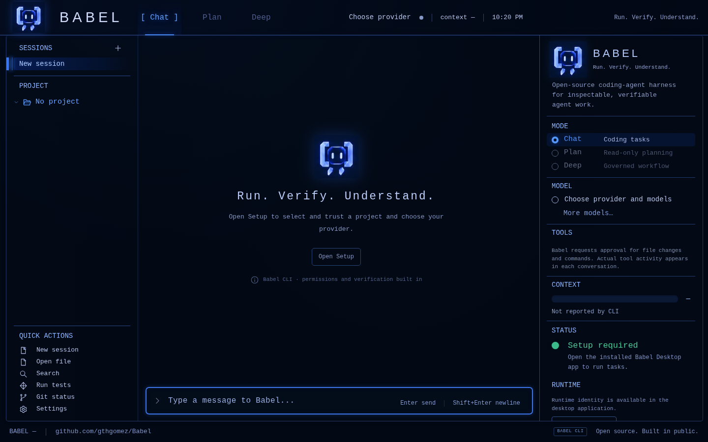
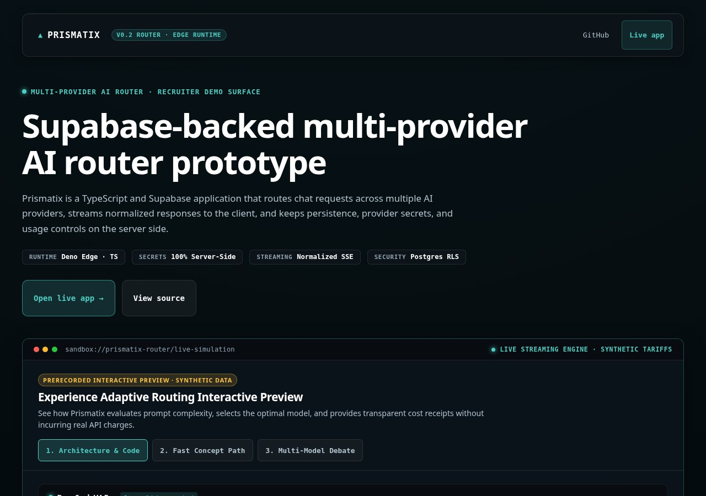
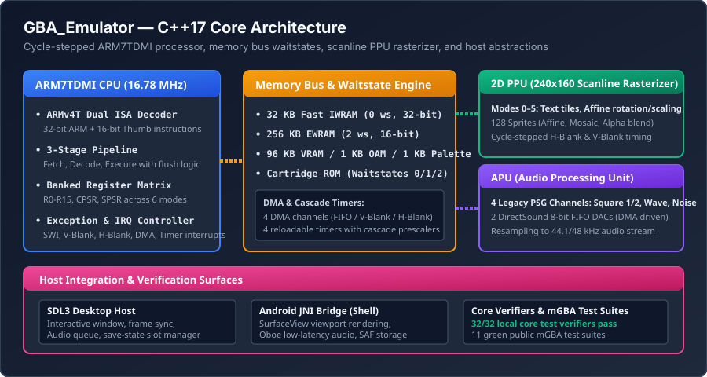
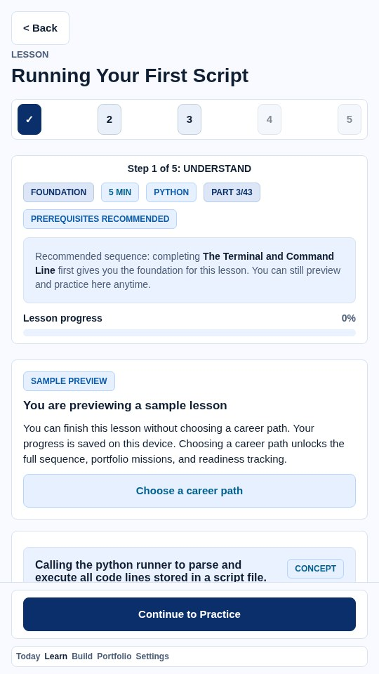
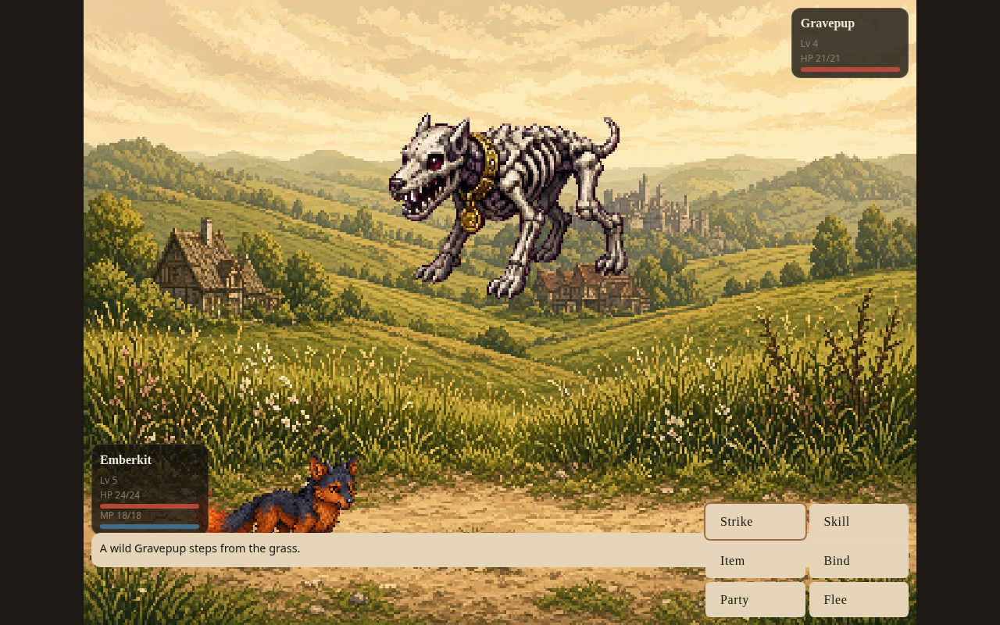

# Jonathan Gomez Aguilar

### Building reliable AI agents, software systems, and interactive applications.

I am a computer science student at Southern New Hampshire University (SNHU). I focus on engineering problems where software correctness, determinism, and inspectability matter:
- **AI Agent Infrastructure & Reliable Execution**: Building governed agent harnesses, execution sandboxes, and evidence-bound completion verifiers.
- **Backend Systems & Data Integrity**: Designing integer-exact financial ledgers, deterministic cash-flow forecasting pipelines, and schema-governed persistence.
- **Low-Level Systems & Emulation**: Modeling cycle-stepped ARM microarchitectures, memory bus waitstates, and scanline-accurate graphics rasterizers in C++17.
- **Interactive Software & Game Engines**: Decoupling headless game simulation from browser rendering, collision geometries, and offline-first Progressive Web Apps.

Python is my primary programming language, complemented by modern TypeScript/JavaScript, C++17, and Kotlin.

---

## Featured Engineering Flagships

The six systems below demonstrate the core of my technical work across AI infrastructure, financial modeling, full-stack routing, computer architecture, offline-first education, and game simulation.

```
1. Babel ─── 2. MonteCarlo-Ledger ─── 3. Prismatix ─── 4. GBA_Emulator ─── 5. ProofPath ─── 6. Reliquary
```

---

### 1. [Babel](https://github.com/gthgomez/Babel) — AI Coding-Agent Runtime & Evidence Verifier
> **Stack**: TypeScript, Node.js, Electron, SQLite FTS, Tree-Sitter | **Role**: Flagship 1 (AI Infrastructure)

[](https://github.com/gthgomez/Babel)

- **The Problem**: AI coding agents routinely suffer from hallucinatory completion—claiming a complex task is resolved without proving that edits compile, pass test suites, or respect project invariants.
- **Technical Solution**: Babel wraps agent execution in an inspectable, multi-interface runtime (CLI, TUI, and desktop). It enforces **evidence-bound task completion**: an agent cannot declare a task done in text alone; it must produce a machine-verifiable execution receipt containing process exit codes, file diffs, and verification proofs.
- **Architecture**: Employs a layered operational prompt hierarchy (System Router, Behavioral OS, Domain Architects, and Model Adapters), an SQLite full-text index for sub-millisecond symbol retrieval, and process supervision with watchdog timeouts.
- **Links**: [Repository](https://github.com/gthgomez/Babel) • [Technical Case Study](docs/case-studies/babel.md) • [Latest Releases](https://github.com/gthgomez/Babel/releases/latest) • [Web Portal](https://babel-origin-site.vercel.app)

---

### 2. [MonteCarlo-Ledger](https://github.com/gthgomez/MonteCarlo-Ledger) — Deterministic Cash-Flow Forecaster & Risk Engine
> **Stack**: Python 3.10+, SQLite, FastAPI, Hypothesis, Pydantic | **Role**: Flagship 2 (Backend & Mathematical Engineering)

[](https://github.com/gthgomez/MonteCarlo-Ledger)

- **The Problem**: Most personal budgeting tools display current balances but cannot evaluate cash-flow fragility: *"How much can I safely spend before my next paycheck without risking a scheduled obligation?"*
- **Technical Solution**: Implements a **two-stage forecasting engine**. Stage 1 projects recurring bills, payroll, and debt amortization onto an exact calendar timeline over a 90-day horizon. Stage 2 executes thousands of seeded Monte Carlo stochastic trials to stress-test that timeline against surprise expenses and paycheck variance.
- **Architecture**: Enforces double-entry ledger bookkeeping where balances are strictly derived from transaction logs. Uses 64-bit integer cents throughout to eliminate floating-point drift. Validated through property-based invariant testing.
- **Links**: [Repository](https://github.com/gthgomez/MonteCarlo-Ledger) • [Technical Case Study](docs/case-studies/monte-carlo-ledger.md) • [Live Web Visualizer](https://montecarlo-ledger.vercel.app) • [Android Companion](https://github.com/gthgomez/MonteCarloLedger-Android)

---

### 3. [Prismatix](https://github.com/gthgomez/Prismatix) — Multi-Provider AI Chat with Cost Governance
> **Stack**: TypeScript, Vite, React, Deno Edge Functions, Supabase Postgres | **Role**: Flagship 3 (Full-Stack Engineering)

[](https://github.com/gthgomez/Prismatix)

- **The Problem**: Multi-model chat interfaces typically operate as opaque proxies: they do not explain why a specific model was selected and fail open during pricing changes, risking unexpected cloud billing spikes.
- **Technical Solution**: A multi-provider AI chat client featuring **explainable model routing**, low-latency Server-Sent Events (SSE) streaming, and **fail-closed budget controls**. When set to Auto mode, an inline inspector displays the evaluated task class, selected model, fallback chain, and cost basis.
- **Architecture**: Built on Deno Edge Functions and Supabase Postgres. Pre-inference admission gates verify user budget reservations before requests reach upstream model providers. Includes client-side authenticated key encryption (BYOK).
- **Links**: [Repository](https://github.com/gthgomez/Prismatix) • [Technical Case Study](docs/case-studies/prismatix.md) • [Live Web App](https://prismatix-app.vercel.app) • [On-Device Companion](https://github.com/gthgomez/PrismLocal)

---

### 4. [GBA_Emulator](https://github.com/gthgomez/GBA_Emulator) — C++17 Emulator Core & Conformance Lab
> **Stack**: C++17, CMake, SDL3, Google Oboe | **Role**: Flagship 4 (Systems Programming & Architecture)

[](https://github.com/gthgomez/GBA_Emulator)

- **The Problem**: Game console emulators often rely on ad-hoc hacks and approximations that sacrifice architectural fidelity, break instruction timing contracts, and fail subtle hardware corner cases.
- **Technical Solution**: A portable Game Boy Advance emulation core built with strict modern C++17 (`-Wall -Wextra -Werror`). Prioritizes cycle-accurate timing, clean hardware abstraction, deterministic headless testing, and transparent public conformance tracking.
- **Architecture**: Implements the ARM7TDMI processor with dual ARMv4T and Thumb instruction decoders, 3-stage pipeline hazard logic, memory waitstate modeling (IWRAM, EWRAM, VRAM, Cartridge ROM), a 2D scanline PPU rasterizer (Modes 0–5), and an APU sound synthesizer.
- **Status & Policy**: Verified across local core verifier binaries and public mGBA test suites. Governed by a strict non-commercial ROM policy using legal, open-source test suites only.
- **Links**: [Repository](https://github.com/gthgomez/GBA_Emulator) • [Technical Case Study](docs/case-studies/gba-emulator.md) • [Open Issues & Conformance Status](https://github.com/gthgomez/GBA_Emulator/blob/main/docs/open-issues-status.md) • [Android Shell](https://github.com/gthgomez/GbaEmulatorAndroid)

---

### 5. [ProofPath](https://github.com/gthgomez/ProofPath) — Offline-First Learning System with Verifiable Proofs
> **Stack**: TypeScript, React Native, Expo, Pyodide (WebAssembly), SQLite | **Role**: Flagship 5 (Product & Education Engineering)

[](https://github.com/gthgomez/ProofPath)

- **The Problem**: Online coding platforms often encourage passive video viewing, rely on expensive server-side cloud sandboxes that stop working offline, and issue certificates that recruiters cannot independently verify.
- **Technical Solution**: An offline-first mobile and web application combining an **in-browser WebAssembly execution sandbox** with **tamper-resistant portfolio evidence export**. Learners write code locally, observe real test suite grading, and export cryptographically signed completion receipts.
- **Architecture**: Bundles Pyodide WebAssembly in an isolated worker thread with watchdog timeout protection. Encrypted local storage retains student progress across offline sessions, with support for JSON backup migration.
- **Links**: [Repository](https://github.com/gthgomez/ProofPath) • [Technical Case Study](docs/case-studies/proofpath.md) • [Project Architecture Notes](https://github.com/gthgomez/ProofPath/blob/main/docs/README.md)

---

### 6. [reliquary](https://github.com/gthgomez/reliquary) — Creature-Collecting Web RPG & Engine
> **Stack**: TypeScript, React, HTML5 Canvas, Vite, Tailwind CSS | **Role**: Flagship 6 (Game Engine & Interactive Systems)

[](https://github.com/gthgomez/reliquary)

- **The Problem**: Web-based games frequently couple game simulation to browser animation frames, causing battle math desync, frame drops, and corrupted save files across version updates.
- **Technical Solution**: A medieval-fantasy creature-binding RPG applying software engineering rigor to web gaming. Features a **pure headless battle engine** decoupled from presentation rendering, a 2D tilemap collision system, safe-spawn algorithms, and full Progressive Web App (PWA) offline support.
- **Architecture**: Turn-based damage and status calculations resolve deterministically upon action confirmation; visual particle effects merely illustrate resolved state. Supports keyboard, gamepad, and responsive mobile touch controls.
- **Links**: [Repository](https://github.com/gthgomez/reliquary) • [Technical Case Study](docs/case-studies/reliquary.md) • [Playable Web Deployment](https://reliquary-dusky.vercel.app) • [Architecture Guide](https://github.com/gthgomez/reliquary/blob/main/docs/ARCHITECTURE.md)

---

## Technical Deep Dives: Difficult Engineering Problems

The following concrete examples illustrate the engineering challenges addressed across these systems:

### 1. Evidence-Bound Completion in Agent Runtimes ([Babel](docs/case-studies/babel.md))
To eliminate agent completion hallucination, Babel decouples text generation from process verification. When an agent proposes code modifications, Babel spawns isolated subprocesses, captures compiler diagnostics and test exit codes, and writes a tamper-evident execution receipt. If a verifier check fails, the harness marks the task blocked regardless of model confidence.

### 2. Path-Dependent Trough Analysis in Finance ([MonteCarlo-Ledger](docs/case-studies/monte-carlo-ledger.md))
Financial risk is chronological. A net-positive monthly balance provides zero protection if an account experiences a liquidity deficit mid-month. MonteCarlo-Ledger models the exact calendar sequence of bills and paychecks before overlaying stochastic variance. Safe-to-spend recommendations are derived from the 10th percentile minimum balance (the trough distribution) rather than optimistic averages.

### 3. Fail-Closed Cost Governance at Edge ([Prismatix](docs/case-studies/prismatix.md))
Multi-model frontends often fail open when upstream providers update model identifiers or modify pricing tables, exposing users to runaway cloud spend. Prismatix implements pre-inference admission reservations on Deno Edge Functions: if a model's token pricing cannot be proven cryptographically against the local registry, the gateway rejects the request with an explicit HTTP 503 error before invoking any paid API.

### 4. Cycle-Stepped Memory Waitstates ([GBA_Emulator](docs/case-studies/gba-emulator.md))
The Game Boy Advance memory bus assigns distinct cycle waitstates to distinct memory regions: 0 waitstates for 32-bit fast IWRAM, 2 waitstates for 16-bit EWRAM, and variable waitstates for cartridge ROM access. GBA_Emulator accurately models these electrical timing constraints inside its C++17 memory controller, ensuring that DMA burst transfers and CPU instruction pipelines synchronize with public hardware test suites.

### 5. Client-Side WASM Sandboxing & Provenance ([ProofPath](docs/case-studies/proofpath.md))
Running user-submitted Python code inside a mobile/web client without server sandboxes requires WebAssembly thread isolation. ProofPath runs Pyodide inside dedicated WebWorkers guarded by execution watchdogs. When a lesson passes, the system calculates SHA-256 digests over the submitted source, test assertions, and execution duration, packaging them into an exportable, audit-ready evidence receipt.

### 6. Decoupling Simulation from Animation Loops ([Reliquary](docs/case-studies/reliquary.md))
If turn-based combat calculations depend on animation timers, backgrounding the browser tab or experiencing frame drops will desynchronize game state. Reliquary models combat as pure, immutable functional state transitions that evaluate immediately upon turn confirmation. The Canvas 2D engine subsequently queues visual effects without delaying game state progression.

---

## How I Build: Engineering Direction & AI Collaboration

I treat software engineering as an intentional discipline centered on requirements clarity, structural boundaries, and reproducible verification.

My personal workflow is documented in detail in [How I Build](docs/how-i-build.md):
- **Human Engineering Direction**: I define system architecture, data models, invariant boundaries, acceptance standards, and error-recovery contracts; investigate root causes when verifiers fail; and evaluate competing technical approaches.
- **AI Coding Agent Implementation**: I pair extensively with AI coding agents to write boilerplate implementations, generate exhaustive unit tests, construct mock fixtures, and explore edge cases.
- **Evidence-First Verification**: No task is declared complete based on AI generated assertions. Success requires passing clean compiler gates, running property-based test suites, and producing reproducible execution logs.

---

## Secondary Projects & Supporting Systems

Beyond the six flagships, my public repositories include specialized developer tools, mobile companions, and game prototypes:

### AI Infrastructure & Developer Tools
| Project | Focus | Interface |
|---|---|---|
| [Scout](https://github.com/gthgomez/Scout) | Policy-governed CLI for finding open-source bounty opportunities and preparing agent handoffs | Local Node.js CLI |
| [PrismLocal](https://github.com/gthgomez/PrismLocal) | Private on-device GGUF inference via llama.cpp JNI bridge with local RAG | Android (Kotlin + C++) |
| [babel-origin-site](https://github.com/gthgomez/babel-origin-site) | Public static web showcase and verification portal for the Babel project | Static Web (Vercel) |

### Backend & Mobile Companions
| Project | Focus | Interface |
|---|---|---|
| [MonteCarloLedger-Android](https://github.com/gthgomez/MonteCarloLedger-Android) | Deterministic bill pacing, offline forecasting, and AES-GCM encrypted backups | Android (Jetpack Compose) |
| [GbaEmulatorAndroid](https://github.com/gthgomez/GbaEmulatorAndroid) | Android development shell for the GBA core with Compose UI and Oboe audio | Android (Kotlin + NDK) |

### Native Mobile Utilities
| Project | Focus | Interface |
|---|---|---|
| [RGRemote](https://github.com/gthgomez/RGRemote) | Local-network Roku and Google TV remote with zero accounts, cloud, or tracking | Android (Jetpack Compose) |
| [ExactUploadFixer](https://github.com/gthgomez/ExactUploadFixer) | Resizes and compresses images to strict dimensional and file-size upload limits | Android (Kotlin) |
| [WallpaperCropFixer](https://github.com/gthgomez/WallpaperCropFixer) | On-device wallpaper cropper with ML Kit face detection and EXIF handling | Android (Kotlin) |

### Games & Strategy Simulations
| Project | Focus | Interface |
|---|---|---|
| [DragonWake](https://github.com/gthgomez/DragonWake) | Multiplayer web MMORTS strategy prototype with isometric city building | Web (TypeScript + Phaser) |
| [GravityPivot](https://github.com/gthgomez/GravityPivot) | Physics-based 2D space navigation web game with gravity anchor swings | Web (TypeScript + Canvas) |
| [ManaNet](https://github.com/gthgomez/ManaNet) | Cyberpunk grid-based tower defense game ported to Godot 4 | Desktop / Godot Engine |
| [Orbitscar](https://github.com/gthgomez/Orbitscar) | Sci-fi tactical strategy prototype featuring deterministic simulation | Web (TypeScript) |

### Upstream Open-Source Forks
| Project | Upstream Origin | Purpose |
|---|---|---|
| [connect](https://github.com/gthgomez/connect) | `commaai/connect` | Vehicle telemetry exploration and openpilot fleet management |
| [rea](https://github.com/gthgomez/rea) | `morluto/rea` | Autonomous agent reverse-engineering framework exploration |

For complete repository licensing, classification, and qualification details, see the [Portfolio Inventory](docs/portfolio-inventory.md) and [Project Index](docs/project-index.md).

---

## Contact & Profile Governance

- **LinkedIn**: [https://linkedin.com/in/gthgomez](https://linkedin.com/in/gthgomez)
- **GitHub**: [https://github.com/gthgomez](https://github.com/gthgomez)

This profile repository is public for portfolio presentation; see its [LICENSE](LICENSE). Referenced projects retain their respective open-source or proprietary licenses.
