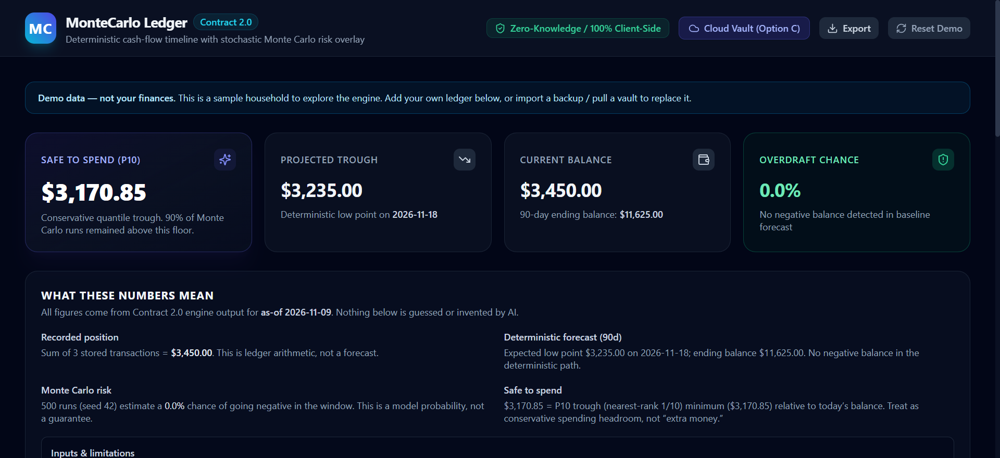
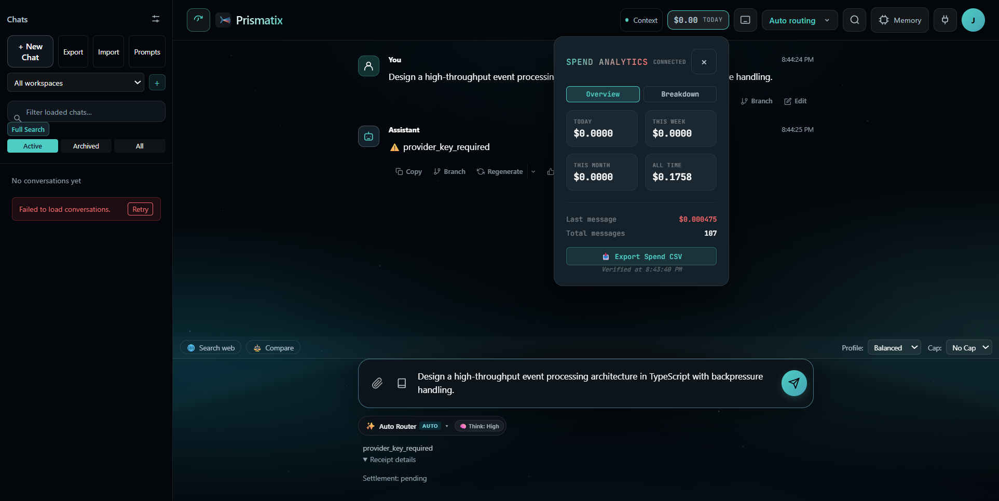

# Jonathan Gomez Aguilar

### Building reliable AI agents, software systems, and interactive applications.

I am a computer science student at Southern New Hampshire University (SNHU). I focus on engineering problems where software correctness, determinism, and inspectability matter:
- **AI Agent Infrastructure & Reliable Execution**: Building governed agent harnesses, execution sandboxes, and evidence-bound completion verifiers.
- **Backend Systems & Data Integrity**: Designing integer-exact financial ledgers, deterministic cash-flow forecasting pipelines, and schema-governed persistence.
- **Low-Level Systems & Emulation**: Modeling cycle-stepped ARM microarchitectures, memory bus waitstates, and scanline-accurate graphics rasterizers in C++17.
- **Interactive Software & Game Engines**: Decoupling headless game simulation from browser rendering, collision geometries, and offline-first Progressive Web Apps.

Python is my primary programming language, complemented by modern TypeScript/JavaScript, C++17, and Kotlin.

---

## Featured Engineering Flagships

The six systems below demonstrate the core of my technical work across AI infrastructure, financial modeling, full-stack routing, computer architecture, offline-first education, and game simulation.

| Flagship | Technical Domain | Primary Stack | Key Verified Deliverable | Case Study |
|---|---|---|---|---|
| **[Babel](#1-babel--ai-coding-agent-runtime--evidence-verifier)** | AI Agent Runtime & Verification | TypeScript, Electron, SQLite | Evidence-bound task completion receipts | [Case Study](docs/case-studies/babel.md) |
| **[MonteCarlo-Ledger](#2-montecarlo-ledger--deterministic-cash-flow-forecaster--risk-engine)** | Deterministic Finance & Risk | Python 3.10+, FastAPI, SQLite | Two-stage calendar pacing + Monte Carlo | [Case Study](docs/case-studies/monte-carlo-ledger.md) |
| **[Prismatix](#3-prismatix--multi-provider-ai-chat-with-cost-governance)** | Multi-Model Routing & Streaming | React, Deno Edge, Supabase | Explainable Auto-Routing & fail-closed admission | [Case Study](docs/case-studies/prismatix.md) |
| **[GBA_Emulator](#4-gba_emulator--c17-emulator-core--conformance-lab)** | Systems & Computer Architecture | C++17, SDL3, CMake | ARMv4T core & mGBA test suite conformance | [Case Study](docs/case-studies/gba-emulator.md) |
| **[ProofPath](#5-proofpath--offline-first-learning-system-with-verifiable-proofs)** | Offline-First Learning & WASM | React Native, Pyodide, SQLite | Pyodide WebWorker sandbox & provenance export | [Case Study](docs/case-studies/proofpath.md) |
| **[reliquary](#6-reliquary--creature-collecting-web-rpg--engine)** | Game Simulation Engine & PWA | TypeScript, React, HTML5 Canvas | Pure headless battle engine & safe-spawn math | [Case Study](docs/case-studies/reliquary.md) |

> [!NOTE]
> All six flagships are pinned publicly on [github.com/gthgomez](https://github.com/gthgomez). Custom pin display reordering requires an authenticated GitHub web session (`BLOCKED_USER_ACTION`).

---

### 1. [Babel](https://github.com/gthgomez/Babel) — AI Coding-Agent Runtime & Evidence Verifier
> **Stack**: TypeScript, Node.js, Electron, SQLite FTS, Tree-Sitter | **Role**: Flagship 1 (AI Infrastructure)  
> **Explore**: [Web Portal](https://babel-origin-site.vercel.app) • [Source Code](https://github.com/gthgomez/Babel) • [Technical Case Study](docs/case-studies/babel.md) • [Releases](https://github.com/gthgomez/Babel/releases)

- **What It Looks Like Running**: A multi-interface desktop client (Electron, TUI, and CLI) where users direct autonomous agents with continuous streaming output, live symbol indexing, and structured task milestones.
- **What Users Accomplish**: Automate software engineering workflows without trusting unverified model text. Babel spawns isolated subprocesses, monitors file modifications, runs project test suites, and issues machine-verifiable completion receipts before declaring tasks complete.
- **Core Engineering Challenge**: Decoupling LLM generation from execution verification. Babel implements an evidence-bound execution harness: if compiler diagnostics or test assertions fail, the harness marks the task blocked regardless of agent confidence.
- **Architecture**: Layered operational prompt hierarchy (System Router, Behavioral OS, Domain Architects, Model Adapters), an SQLite full-text index for fast heuristic symbol lookup, and process supervision with watchdog timeouts.

---

### 2. [MonteCarlo-Ledger](https://github.com/gthgomez/MonteCarlo-Ledger) — Deterministic Cash-Flow Forecaster & Risk Engine
> **Stack**: Python 3.10+, SQLite, FastAPI, Hypothesis, Pydantic | **Role**: Flagship 2 (Backend & Mathematical Engineering)  
> **Explore**: [Try Live App](https://montecarlo-ledger.vercel.app) • [Source Code](https://github.com/gthgomez/MonteCarlo-Ledger) • [Technical Case Study](docs/case-studies/monte-carlo-ledger.md) • [Android Companion](https://github.com/gthgomez/MonteCarloLedger-Android)

- **What It Looks Like Running**: An interactive web companion featuring a 90-day cash-flow timeline, live Safe-to-Spend P10 quantile gauges, projected liquidity trough indicators, and an interactive What-If Decision Studio with real-time fragility sliders.
- **What Users Accomplish**: Evaluate cash-flow fragility and answer critical financial questions before spending: *"How much can I safely spend today without bouncing an upcoming obligation?"*
- **Core Engineering Challenge**: Financial risk is path-dependent. Standard monthly budgeting tools ignore exact calendar sequencing: rent on the 1st vs. payroll on the 15th causes an overdraft even if the month ends positive. MonteCarlo-Ledger implements a **two-stage forecasting engine**: Stage 1 projects known commitments onto an exact calendar timeline; Stage 2 executes thousands of seeded Monte Carlo stochastic trials to stress-test that timeline against surprise expenses.
- **Architecture**: Enforces a signed-transaction integer-cents ledger (`amount INTEGER NOT NULL`, `type IN ('Income', 'Expense', 'Adjustment')`) where balances are strictly derived from transaction log deltas. Uses 64-bit integer cents throughout to eliminate floating-point drift, validated through property-based invariant testing.

---

### 3. [Prismatix](https://github.com/gthgomez/Prismatix) — Multi-Provider AI Chat with Cost Governance
> **Stack**: TypeScript, Vite, React, Deno Edge Functions, Supabase Postgres | **Role**: Flagship 3 (Full-Stack Engineering)  
> **Explore**: [Try Live App](https://prismatix-app.vercel.app) • [Source Code](https://github.com/gthgomez/Prismatix) • [Technical Case Study](docs/case-studies/prismatix.md) • [On-Device Companion](https://github.com/gthgomez/PrismLocal)

- **What It Looks Like Running**: A modern multi-model chat workspace showing live explainable auto-routing, real-time spend analytics ($0.1758 all-time settled, live turn tracking), per-turn spend caps, and model-tier complexity scoring.
- **What Users Accomplish**: Access premier frontier models (Claude, GPT, Gemini, DeepSeek) through a single unified interface with transparent cost attribution, automatic task-based model selection, and multi-model debate synthesis.
- **Core Engineering Challenge**: Eliminating vendor opacity and runaway cloud spend. Prismatix implements **explainable model routing** paired with **fail-closed budget controls** on Deno Edge Functions. Unpriced models fail closed with an explicit HTTP 409 Conflict, and admission database outages return HTTP 503 before invoking external providers.
- **Architecture**: Built on Deno Edge Functions and Supabase Postgres. Features client-side BYOK key encryption (AES-256-GCM), streaming token counters, and post-stream settlement receipts. Production web deployment runs commit `7d143a1`.

---

### 4. [GBA_Emulator](https://github.com/gthgomez/GBA_Emulator) — C++17 Emulator Core & Conformance Lab
> **Stack**: C++17, CMake, SDL3, Google Oboe | **Role**: Flagship 4 (Systems Programming & Architecture)  
> **Explore**: [Source Code](https://github.com/gthgomez/GBA_Emulator) • [Technical Case Study](docs/case-studies/gba-emulator.md) • [Open Issues & Conformance Status](https://github.com/gthgomez/GBA_Emulator/blob/main/docs/open-issues-status.md) • [Android Shell](https://github.com/gthgomez/GbaEmulatorAndroid)

- **What It Looks Like Running**: A high-performance C++17 desktop emulator (`gba-desktop.exe`) executing interactive synthetic video and timing conformance suites at 3x integer scale (720x480) with real-time 60 fps scanline rasterization.
- **What Users Accomplish**: Study cycle-stepped computer architecture, inspect ARMv4T pipeline hazards, and run verified homebrew and conformance test suites on a modular, portable emulation core.
- **Core Engineering Challenge**: Accurate hardware timing and bus waitstates without ad-hoc game hacks. The memory bus controller accurately models electrical waitstates: 0 waitstates for 32-bit IWRAM, 2 waitstates for 16-bit EWRAM, and configurable waitstates for Game Pak ROM.
- **Status & Policy**: Verified across 32 local core verifiers and public mGBA test suites (11/13 green). Testing is performed strictly against open-source synthetic suites; commercial ROM compatibility remains untested per legal policy.

---

### 5. [ProofPath](https://github.com/gthgomez/ProofPath) — Offline-First Learning System with Verifiable Proofs
> **Stack**: TypeScript, React Native, Expo, Pyodide (WebAssembly), SQLite | **Role**: Flagship 5 (Product & Education Engineering)  
> **Explore**: [Source Code](https://github.com/gthgomez/ProofPath) • [Technical Case Study](docs/case-studies/proofpath.md) • [Architecture Notes](https://github.com/gthgomez/ProofPath/blob/main/docs/README.md)

- **What It Looks Like Running**: An interactive mobile and web learning application where students write and execute real Python code directly inside the browser with immediate automated test assertion feedback.
- **What Users Accomplish**: Master programming fundamentals completely offline, execute code without paid server sandboxes, and export verifiable JSON evidence packets demonstrating genuine problem-solving mastery.
- **Core Engineering Challenge**: Running untrusted Python code safely in the browser without server dependencies while generating tamper-evident learning records. ProofPath isolates Pyodide WebAssembly inside dedicated WebWorkers with execution watchdogs, computing a 32-bit DJB2 content hash over passing code.
- **Architecture**: Bundles Pyodide WebAssembly with a local SQLite database for offline progress retention, supporting structured JSON portfolio export under a 4-tier evidence trust model.

---

### 6. [reliquary](https://github.com/gthgomez/reliquary) — Creature-Collecting Web RPG & Engine
> **Stack**: TypeScript, React, HTML5 Canvas, Vite, Tailwind CSS | **Role**: Flagship 6 (Game Engine & Interactive Systems)  
> **Explore**: [Play Live Game](https://reliquary-dusky.vercel.app) • [Source Code](https://github.com/gthgomez/reliquary) • [Technical Case Study](docs/case-studies/reliquary.md) • [Engine Architecture](https://github.com/gthgomez/reliquary/blob/main/docs/ARCHITECTURE.md)

- **What It Looks Like Running**: A playable web-based creature-binding RPG featuring turn-based tactical combat, Elderhall exploration on 2D tilemaps, creature party management, and responsive gamepad/touch controls.
- **What Users Accomplish**: Play an authentic retro-style creature RPG in any browser, explore procedural wild encounter zones, and battle with deterministic state transitions that persist across offline sessions via PWA storage.
- **Core Engineering Challenge**: Eliminating simulation-rendering desync. Many web games tie game math to `requestAnimationFrame`, causing calculations to desync or drop inputs when backgrounded. Reliquary decouples game simulation into a **pure headless battle engine**: state transitions evaluate immediately upon action confirmation, and Canvas visual effects merely render the resolved state.
- **Architecture**: Pure functional battle logic, safe-spawn Poisson tile placement, Progressive Web App service worker caching, and schema-versioned `localStorage` save migrations.

---

## Technical Deep Dives: Difficult Engineering Problems

The following concrete examples illustrate the engineering challenges addressed across these systems:

### 1. Evidence-Bound Completion in Agent Runtimes ([Babel](docs/case-studies/babel.md))
To eliminate agent completion hallucination, Babel decouples text generation from process verification. When an agent proposes code modifications, Babel spawns isolated subprocesses, captures compiler diagnostics and test exit codes, and writes a structured execution receipt. If a verifier check fails, the harness marks the task blocked regardless of model confidence.

### 2. Path-Dependent Trough Analysis in Finance ([MonteCarlo-Ledger](docs/case-studies/monte-carlo-ledger.md))
Financial risk is chronological. A net-positive monthly balance provides zero protection if an account experiences a liquidity deficit mid-month. MonteCarlo-Ledger models the exact calendar sequence of bills and paychecks before overlaying stochastic variance. Safe-to-spend recommendations are derived from the 10th percentile minimum balance (the trough distribution) rather than optimistic averages.

### 3. Fail-Closed Cost Governance at Edge ([Prismatix](docs/case-studies/prismatix.md))
Multi-model frontends often fail open when upstream providers update model identifiers or modify pricing tables, exposing users to runaway cloud spend. Prismatix implements pre-inference admission reservations on Deno Edge Functions: unpriced models fail closed with an explicit HTTP 409 Conflict, while admission database outages return HTTP 503, preventing untracked spend before invoking external providers.

### 4. Cycle-Stepped Memory Waitstates ([GBA_Emulator](docs/case-studies/gba-emulator.md))
The Game Boy Advance memory bus assigns distinct cycle waitstates to distinct memory regions: 0 waitstates for 32-bit fast IWRAM, 2 waitstates for 16-bit EWRAM, and variable waitstates for cartridge ROM access. GBA_Emulator accurately models these electrical timing constraints inside its C++17 memory controller, ensuring that DMA burst transfers and CPU instruction pipelines synchronize with public hardware test suites.

### 5. Client-Side WASM Sandboxing & Provenance ([ProofPath](docs/case-studies/proofpath.md))
Running user-submitted Python code inside a mobile/web client without server sandboxes requires WebAssembly thread isolation. ProofPath runs Pyodide inside dedicated WebWorkers guarded by execution watchdogs. When a lesson passes, the system calculates a 32-bit DJB2 content hash (`cf-` prefix) over the submitted source, tracks test suite assertions, and packages the results into a structured JSON evidence packet.

### 6. Decoupling Simulation from Animation Loops ([Reliquary](docs/case-studies/reliquary.md))
If turn-based combat calculations depend on animation timers, backgrounding the browser tab or experiencing frame drops will desynchronize game state. Reliquary models combat as pure, immutable functional state transitions that evaluate immediately upon turn confirmation. The Canvas 2D engine subsequently queues visual effects without delaying game state progression.

---

## How I Build: Engineering Direction & AI Collaboration

I treat software engineering as an intentional discipline centered on requirements clarity, structural boundaries, and reproducible verification.

My personal workflow is documented in detail in [How I Build](docs/how-i-build.md):
- **Human Engineering Direction**: I define system architecture, data models, invariant boundaries, acceptance standards, and error-recovery contracts; investigate root causes when verifiers fail; and evaluate competing technical approaches.
- **AI Coding Agent Implementation**: Autonomous coding agents contribute substantial implementation across core algorithms, test suites, CLI parsers, and component structures, executing under close human architectural direction, requirements specification, root-cause investigation, and invariant governance.
- **Evidence-First Verification**: No task is declared complete based on AI generated assertions. Success requires passing clean compiler gates, running property-based test suites, and producing reproducible execution logs.

---

## Secondary Projects & Supporting Systems

Beyond the six flagships, my public repositories include specialized developer tools, mobile companions, and game prototypes:

### AI Infrastructure & Developer Tools
| Project | Focus | Interface |
|---|---|---|
| [Scout](https://github.com/gthgomez/Scout) | Policy-governed CLI for finding open-source bounty opportunities and preparing agent handoffs | Local Node.js CLI |
| [PrismLocal](https://github.com/gthgomez/PrismLocal) | Private on-device GGUF inference via llama.cpp JNI bridge with local RAG | Android (Kotlin + C++) |
| [babel-origin-site](https://github.com/gthgomez/babel-origin-site) | Public static web showcase and verification portal for the Babel project | Static Web (Vercel) |

### Backend & Mobile Companions
| Project | Focus | Interface |
|---|---|---|
| [MonteCarloLedger-Android](https://github.com/gthgomez/MonteCarloLedger-Android) | Deterministic bill pacing, offline forecasting, and AES-GCM encrypted backups | Android (Jetpack Compose) |
| [GbaEmulatorAndroid](https://github.com/gthgomez/GbaEmulatorAndroid) | Android development shell for the GBA core with Compose UI and Oboe audio | Android (Kotlin + NDK) |

### Native Mobile Utilities
| Project | Focus | Interface |
|---|---|---|
| [RGRemote](https://github.com/gthgomez/RGRemote) | Local-network Roku and Google TV remote with zero accounts, cloud, or tracking | Android (Jetpack Compose) |
| [ExactUploadFixer](https://github.com/gthgomez/ExactUploadFixer) | Resizes and compresses images to strict dimensional and file-size upload limits | Android (Kotlin) |
| [WallpaperCropFixer](https://github.com/gthgomez/WallpaperCropFixer) | On-device wallpaper cropper with ML Kit face detection and EXIF handling | Android (Kotlin) |

### Games & Strategy Simulations
| Project | Focus | Interface |
|---|---|---|
| [DragonWake](https://github.com/gthgomez/DragonWake) | Multiplayer web MMORTS strategy prototype with isometric city building | Web (TypeScript + Phaser) |
| [GravityPivot](https://github.com/gthgomez/GravityPivot) | Physics-based 2D space navigation web game with gravity anchor swings | Web (TypeScript + Canvas) |
| [ManaNet](https://github.com/gthgomez/ManaNet) | Cyberpunk grid-based tower defense game ported to Godot 4 | Desktop / Godot Engine |
| [Orbitscar](https://github.com/gthgomez/Orbitscar) | Sci-fi tactical strategy prototype featuring deterministic simulation | Web (TypeScript) |

### Upstream Open-Source Forks
| Project | Upstream Origin | Purpose |
|---|---|---|
| [connect](https://github.com/gthgomez/connect) | `commaai/connect` | Vehicle telemetry exploration and openpilot fleet management |
| [rea](https://github.com/gthgomez/rea) | `morluto/rea` | Autonomous agent reverse-engineering framework exploration |

For complete repository licensing, classification, and qualification details, see the [Portfolio Inventory](docs/portfolio-inventory.md) and [Project Index](docs/project-index.md).

---

## Contact & Profile Governance

- **LinkedIn**: [https://linkedin.com/in/gthgomez](https://linkedin.com/in/gthgomez)
- **GitHub**: [https://github.com/gthgomez](https://github.com/gthgomez)

This profile repository is public for portfolio presentation; see its [LICENSE](LICENSE). Referenced projects retain their respective open-source or proprietary licenses.
