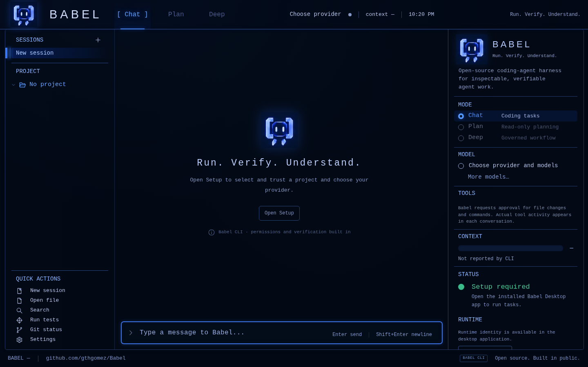
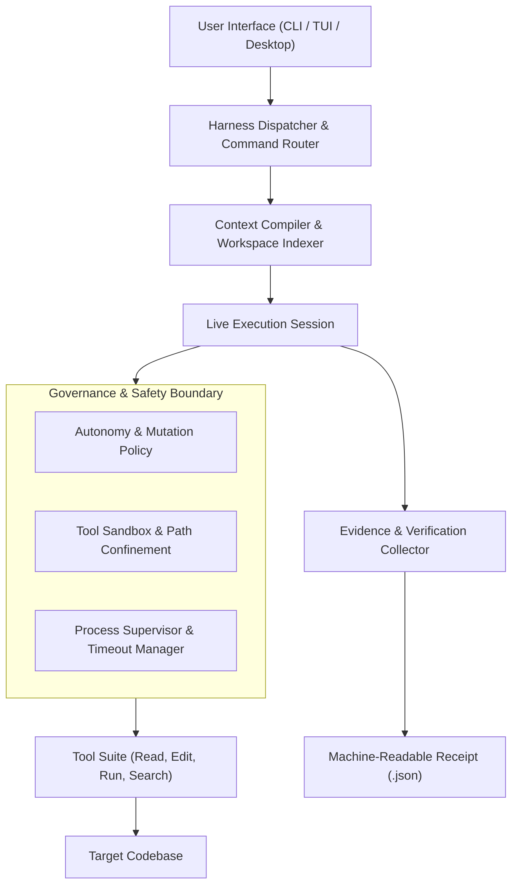
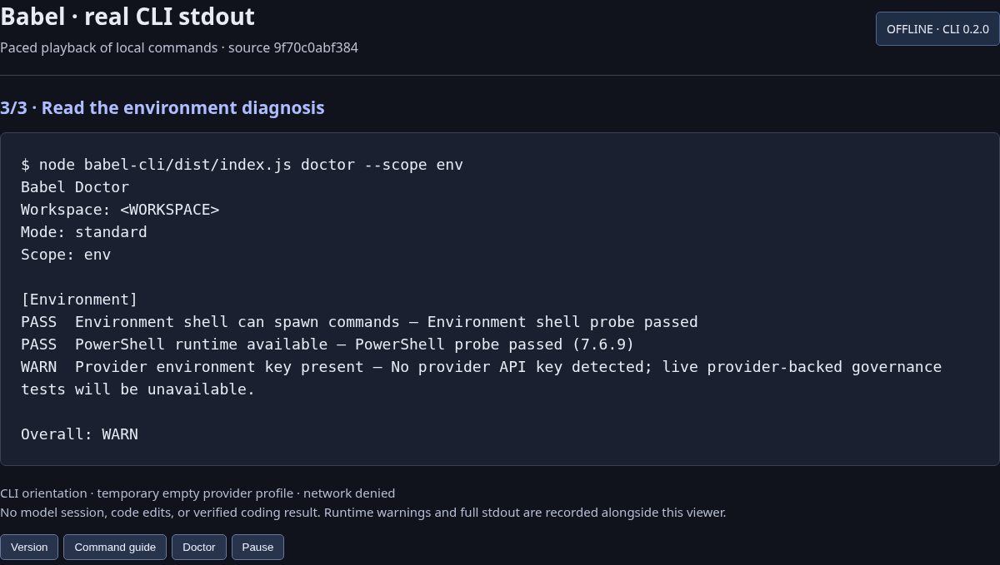

# Engineering Case Study: Babel

**Open-source coding-agent runtime with CLI, TUI, and desktop interfaces, sandboxed execution, and evidence-based verification.**

## 1. Problem Being Solved

Most coding agents suffer from a fundamental trust gap: they declare tasks complete without machine-verifiable proof that code edits actually compile, pass tests, and satisfy safety constraints. When autonomous agents operate on large codebases, hallucinations, silent regressions, out-of-scope edits, and uncontrolled file system modifications frequently degrade developer confidence.

Babel solves this problem by providing a governed coding-agent harness with multi-interface access (CLI, terminal TUI, and desktop GUI) centered around **evidence-bound completion**. An agent operating under Babel cannot simply claim success in text; it must produce verifiable execution receipts, observe file locks, respect sandbox policies, and pass deterministic verification checks before an edit can be committed.

## 2. Intended Users

- **Software Engineers & Technical Leads**: Developers who want autonomous coding assistance without sacrificing git discipline, architectural invariants, or workspace safety.
- **AI Infrastructure Researchers**: Engineers exploring multi-turn agent harnesses, prompt layering, subagent coordination, and bounded autonomous execution loops.
- **Enterprise & Open-Source Maintainers**: Teams requiring reproducible audit trails for automated pull requests and bug fixes.

## 3. Why the Problem Is Technically Difficult

1. **Hallucinatory Completion vs. Physical Truth**: Large language models easily claim they fixed a bug without executing tests or understanding compiler errors. Enforcing that model claims align with actual process exit codes requires strict process boundary isolation.
2. **Context Window Degradation & Compaction**: As multi-turn agent sessions grow across large repositories, context windows fill up. Naive truncation loses load-bearing facts, while naive re-prompting incurs excessive token costs. Babel requires deterministic memory compaction and context checkpointing.
3. **Cross-Platform Host Integration**: Operating cleanly across Windows (PowerShell/cmd), macOS, and Linux requires handling disparate process tree termination semantics, path normalization, shell quoting, and terminal escape sequences across CLI, TUI, and Electron desktop environments.

## 4. Architecture and Major Subsystems

- **CLI & TUI Engine (`babel-cli`)**: Node.js/TypeScript runtime supporting command-line switches, streaming interactive terminal sessions, full-screen TUI dashboards, and doctor diagnostics.
- **Desktop Application (`babel-desktop`)**: Cross-platform desktop interface providing visual prompt inspection, multi-turn diff reviews, interactive approvals, and live session replay.
- **Workspace Indexer & Context Compiler**: SQLite-backed full-text search (`fts-index.db`) and tree-sitter grammar parsing supporting fast heuristic symbol extraction, outline generation, and identifier reference lookup.
- **Evidence Collector & Verifier**: Collects compiler logs, test outputs, file diffs, and content hashes into structured verification receipts.

## 5. Important Engineering Decisions

- **Receipt-Gated Task Completion**: Every automated intervention produces an evidence receipt capturing execution exit codes, affected files, and test verification state. Babel explicitly distinguishes between verified-complete runs (where automated tests execute and pass), unverified patches (code changes generated without verification execution), and blocked/failing runs, preventing false-positive completion claims.
- **Layered Prompt Architecture**: Prompt policy is decomposed into clean, composable layers: System Router (00), Behavioral OS (01), Domain Architects (02), and Model Adapters (03). This avoids giant monolith prompts and allows model-specific fine-tuning without changing core business logic.
- **Fail-Closed Permission Model**: File system edits outside the declared target workspace or attempts to execute unapproved shell sequences fail closed immediately.

## 6. Alternatives and Tradeoffs

| Approach | Tradeoff Made in Babel | Why Selected |
|---|---|---|
| Unrestricted Shell Access vs. Sandboxed Tool Execution | Sandboxed execution with explicit approval gates | Unrestricted shell access allows agents to run destructive commands; sandboxing guarantees workspace confinement. |
| Single Large Prompt vs. Layered Operational Prompts | Composable layered prompts | Layered prompts allow independent auditing and adapter swapping per LLM provider without regression. |
| In-Memory Session History vs. Persistent Checkpointing | Disk-backed SQLite + JSONL event stream | Enables instant crash recovery, session handoffs, and offline debugging without data loss. |

## 7. Interesting Implementation Details

- **Deterministic Compaction Oracle**: When context window thresholds are approached, Babel summarizes completed subtasks into structured milestone capsules while preserving active error traces, active file hashes, and unfulfilled requirements.
- **Process Supervisor**: Subprocesses are spawned in dedicated process groups with aggressive watchdog timers. If a test runner hangs or enters an infinite loop, Babel cleanly terminates the entire process tree without leaving orphaned zombie processes.

## 8. Reproducible Tests and Validation

The project maintains extensive unit, integration, and benchmark suites:
- **Core CLI Verification**: Run via `npm test` inside `babel-cli`, exercising tool execution, prompt formatting, and error recovery.
- **Doctor Diagnostic Suite**: Accessible via `babel doctor` to verify local node engines, git boundaries, provider connectivity, and toolchain prerequisites.
- **Canary Benchmark**: Exercises end-to-end coding loops against oracle repositories to verify multi-file refactoring accuracy.

## 9. User-Facing Demonstration

In the desktop and TUI interfaces, developers:
1. Launch Babel against a project repository.
2. Formulate a task in natural language with optional constraints.
3. Observe real-time tool execution, diff previews, and compiler feedback.
4. Review the final evidence receipt confirming test execution before approving a branch commit.

## 10. Current Limitations

- **Commercial LLM API Latency**: Deep reasoning tasks depend on upstream provider latency and rate limits.
- **Long-Horizon Autonomy Boundaries**: While single-task and multi-file refactors achieve high pass rates, broad architectural migrations across dozens of files still require human milestone review.
- **Platform Packaging**: Shipped binary distributions are periodically refreshed as upstream Electron and Node runtimes advance.

## 11. Specific Contributions and AI-Assisted Workflow

- **Engineering Direction**: Formulated the evidence-bound execution philosophy, designed the layered prompt system, established verification receipt schemas, and guided process isolation boundaries.
- **AI Agent Pairing**: Autonomous coding agents performed substantial code implementation across CLI parsers, mock provider fixtures, TypeScript types, and unit tests, working under human architectural direction, invariant governance, and adversarial review.

## 12. Links and Verification References

- **Canonical Repository**: [https://github.com/gthgomez/Babel](https://github.com/gthgomez/Babel)
- **Releases & Distribution**: [https://github.com/gthgomez/Babel/releases](https://github.com/gthgomez/Babel/releases)
- **Origin Web Portal**: [https://babel-origin-site.vercel.app](https://babel-origin-site.vercel.app)
