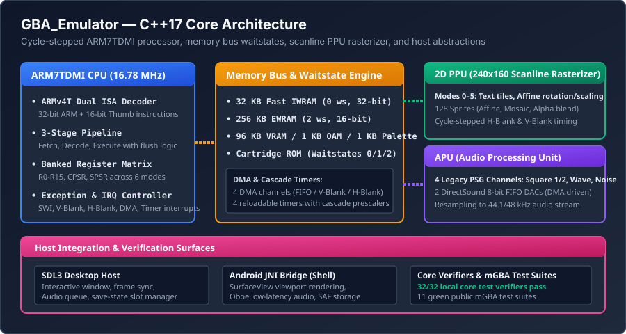
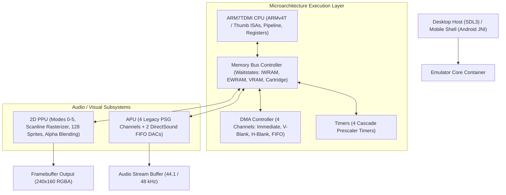

# Engineering Case Study: GBA_Emulator

**C++17 Game Boy Advance emulator core with an SDL desktop host, deterministic tests, and public hardware-conformance evidence.**



## 1. Problem Being Solved

Video game console emulation is often approached as a loose collection of ad-hoc hacks and approximations designed to run a few popular commercial titles at 60 fps, sacrificing architectural fidelity and deterministic correctness. Such implementations frequently break subtle timing contracts, fail edge-case CPU instruction flags, corrupt save states, and create untracked behavioral regressions.

GBA_Emulator approaches Game Boy Advance emulation from a **disciplined systems-programming perspective**. Built in modern C++17, the core prioritizes hardware conformance, strict compiler diagnostics (`-Wall -Wextra -Werror`), explicit cycle-stepped memory waitstate modeling, deterministic headless testing, and transparent public tracking against authoritative third-party test suites (such as the mGBA test suite).

## 2. Intended Users

- **Systems Engineers & Low-Level Programmers**: Developers interested in cycle-accurate CPU pipelines, memory-mapped I/O, scanline rasterization, and hardware timer cascade logic.
- **Computer Architecture Students**: Learners studying ARMv4T microarchitecture, dual instruction set decoding (ARM and Thumb), and register banking across CPU privilege modes.
- **Embedded & Retro-Computing Enthusiasts**: Programmers looking for a clean, modular, portable C++17 emulation core with minimal external dependencies.

## 3. Why the Problem Is Technically Difficult

1. **Dual ISA ARMv4T Decoding & Pipeline Hazards**: The ARM7TDMI processor executes both 32-bit ARM instructions and compact 16-bit Thumb instructions. Emulating a 3-stage instruction pipeline (Fetch, Decode, Execute) requires modeling pipeline flushes during branch instructions, PC-relative addressing offsets, and conditional execution flags (N, Z, C, V) across 37 banked registers.
2. **Cycle-Accurate Bus Waitstates**: The GBA memory map has distinct electrical timing characteristics: Internal Work RAM (IWRAM) runs at 0 waitstates on a 32-bit bus; External Work RAM (EWRAM) requires 2 waitstates on a 16-bit bus; and Game Pak ROM access requires configurable waitstates (cycles 4/3/2/1) depending on cartridge headers and sequential access flags.
3. **Scanline-Synchronized PPU & DMA**: The Picture Processing Unit renders 240x160 pixels line by line across 4 distinct background modes and 2 affine transformation modes. Direct Memory Access (DMA) channels must trigger synchronously during H-Blank or V-Blank intervals without causing race conditions or audio buffer underruns.

## 4. Architecture and Major Subsystems



- **ARM7TDMI CPU Core**: Full implementation of ARM and Thumb instruction sets, ALU condition evaluation, barrel shifter operations, multiplication extensions, and software interrupts (SWI).
- **Bus & Memory Controller**: Maps 256 KB EWRAM, 32 KB IWRAM, 96 KB VRAM, 1 KB Palette RAM, 1 KB OAM, and Game Pak address spaces with configurable sequential and non-sequential bus waitstates.
- **2D PPU Rasterizer**: Line-by-line renderer supporting background tile maps, affine rotation and scaling, window clipping, sprite priority sorting, mosaic filters, and alpha blending.
- **Audio Processing Unit (APU)**: Emulates the four legacy Game Boy PSG audio channels (two square wave channels with frequency sweep, one wave pattern RAM channel, and one noise generator) alongside two 8-bit DirectSound DMA-driven FIFOs.
- **Desktop Host (SDL3)**: Native desktop frontend handling window lifecycle, keyboard/gamepad event mapping, audio ring-buffering, and save-state serialization.
- **Android Dev Shell (`GbaEmulatorAndroid`)**: Sibling native Android shell utilizing a JNI bridge, SurfaceView hardware rendering, and Google Oboe low-latency audio.

## 5. Important Engineering Decisions

- **Strict Warnings-as-Errors Compilation**: Built with `g++ -std=c++17 -Wall -Wextra -Werror` on both Windows and Linux, guaranteeing zero compiler warnings, zero implicit type truncations, and strict sign-comparison hygiene.
- **Separation of Core Engine from Host Presentation**: The emulation core contains zero windowing or operating system dependencies. Host frontends (SDL3 or Android) communicate strictly through clean C++ interfaces: passing input bitmasks, receiving audio frames, and reading the 240x160 RGB pixel buffer.
- **Strict Legal & Non-Commercial ROM Stance**: The repository does not bundle or test commercial ROMs. Verification is conducted exclusively using public, open-source test suites (such as the mGBA hardware test suite) built from assembly or legal C sources.

## 6. Alternatives and Tradeoffs

| Alternative Considered | Chosen Approach | Rationale |
|---|---|---|
| Dynamic Recompiler (JIT) | Clean Cycle-Stepped Interpreter | Interpreter prioritizes portability, determinism, inspectability, and ease of debugging across platforms without complex native assembly backends. |
| Frame-Based PPU Rendering | Scanline-Based PPU Rendering | Essential for games and test suites that modify display registers (e.g., HDMA palette changes, affine scroll splits) mid-frame. |
| Monolithic Host/Core Application | Decoupled Core Library + Separate Frontends | Core can be integrated into CLI test runners, SDL3 desktop hosts, or Android mobile applications without architectural modification. |

## 7. Interesting Implementation Details

- **Deterministic Headless Test Lab**: The core includes a headless execution mode that runs test ROMs for a discrete number of cycles, dumps register states, and compares memory and video hashes against authoritative expected baselines.
- **Cartridge Save Integrity**: Implements robust save-state ROM-association guards. Save states verify cartridge checksums before restoration, preventing cross-ROM state corruption.

## 8. Reproducible Tests and Validation

The project maintains rigorous automated verification:
- **Local Core Verifiers**: 32 distinct C++ test binaries validating CPU instructions, barrel shifter logic, memory waitstate timing, and interrupt handling:
```powershell
.\tools\run-core-tests.ps1
```
All 32 local core test binaries pass cleanly on Windows and Linux runners with zero warnings.
- **Public mGBA Conformance Suites**: Benchmarked against 13 public test suites from the respected mGBA project:
  - 11 suites are fully **GREEN** (including `io-read`, `memory`, `arm`, and `thumb`).
  - 2 suites (`timing` and `misc-edge`) are tracked with known pre-existing timing nuances, documented transparently in `docs/open-issues-status.md`.

## 9. User-Facing Demonstration

Running the desktop interactive host:
1. Compile and launch `gba-desktop` via CMake.
2. Load an open-source test ROM or homebrew binary.
3. Observe real-time 60 fps rendering at 240x160 resolution scaled with integer nearest-neighbor or bilinear filtering.
4. Test real-time input handling, audio playback, cartridge persistence, and instant save/load states.

## 10. Current Limitations

- **Hardware Conformance Coverage**: While core instruction and memory tests are green, complex sub-cycle timing corner cases (`timing` suite 1956/2020) remain open for future hardening.
- **Physical Mobile Optimization**: Android physical-device qualification identified audio buffer underruns under throttled mobile CPU governors, maintained transparently as a known roadmap item in `docs/evidence/`.

## 11. Specific Contributions and AI-Assisted Workflow

- **Engineering Direction**: Architected the C++17 class hierarchy, specified CPU register banking structures, implemented memory waitstate tables, configured CMake build matrices, and defined conformance verification baselines.
- **AI Agent Pairing**: Coding agents assisted in generating opcode unit test cases, Thumb instruction bit-pattern lookup tables, and build scripts under human architectural specifications, register model design, and conformance debugging.

## 12. Links and Verification References

- **Canonical Repository**: [https://github.com/gthgomez/GBA_Emulator](https://github.com/gthgomez/GBA_Emulator)
- **Sibling Android Shell**: [https://github.com/gthgomez/GbaEmulatorAndroid](https://github.com/gthgomez/GbaEmulatorAndroid)
- **Conformance & Issue Status**: [https://github.com/gthgomez/GBA_Emulator/blob/main/docs/open-issues-status.md](https://github.com/gthgomez/GBA_Emulator/blob/main/docs/open-issues-status.md)
