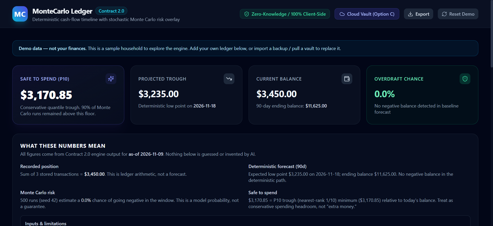
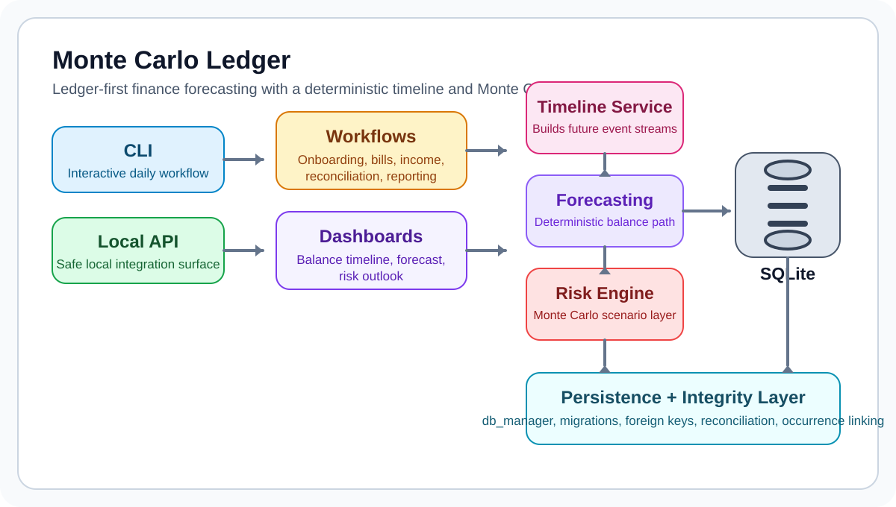
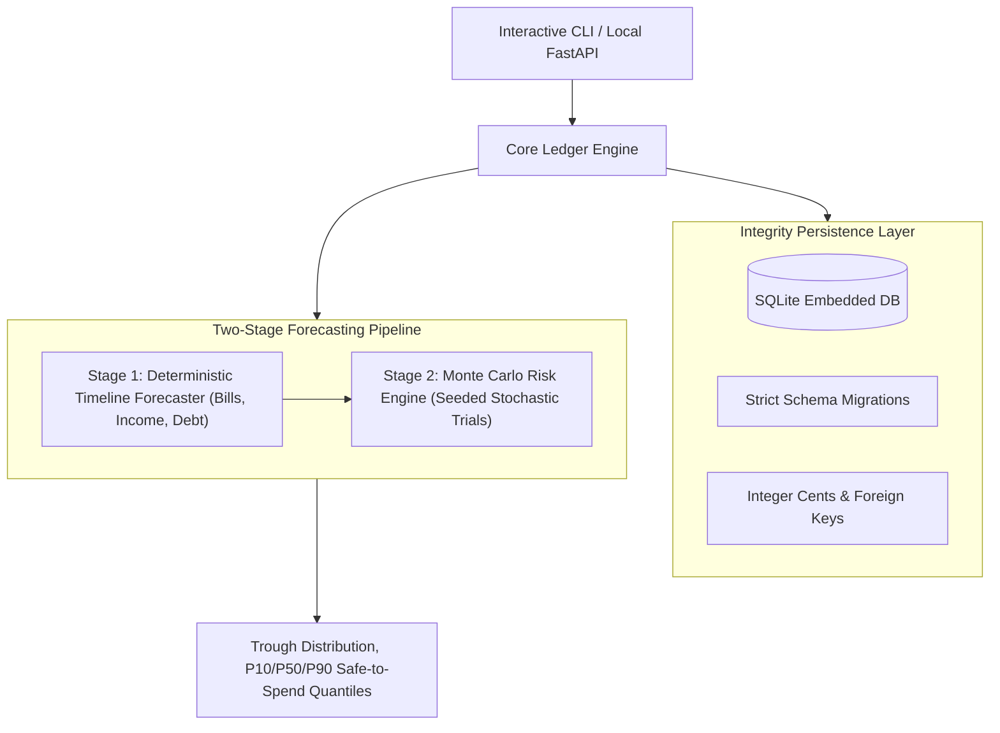
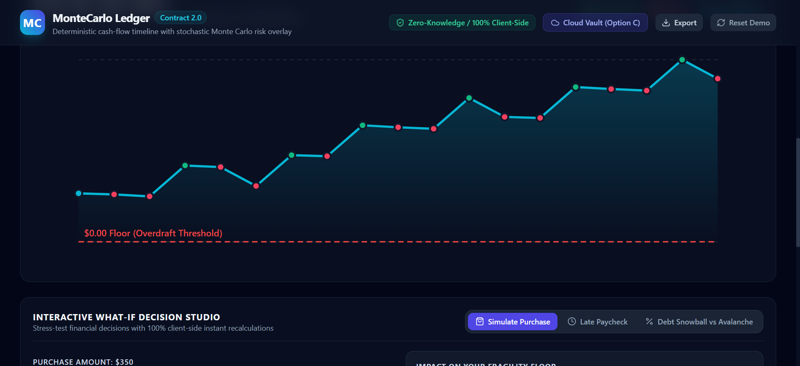

# Engineering Case Study: MonteCarlo-Ledger

**Local-first Python financial ledger with deterministic cash-flow forecasts, Monte Carlo risk modeling, and contract-based tests.**



## 1. Problem Being Solved

Traditional personal finance tools suffer from two major flaws:
1. **Static Balance Fallacy**: Most personal budgeting apps only report your current bank balance or categorised historical spend. They fail to answer the critical operational question: *"How much can I safely spend before my next paycheck without bouncing a scheduled bill?"*
2. **Naive Stochastic Modeling**: Pure statistical budgeting tools apply generic random walks to monthly totals, ignoring the deterministic reality of calendar dates: rent is due on the 1st, payroll arrives on the 15th, and a shortfall on the 14th causes an overdraft even if the month ends net-positive.

MonteCarlo-Ledger solves this by decoupling financial forecasting into a **two-stage architecture**: first constructing a deterministic timeline of known calendar commitments, and then stress-testing that timeline with bounded Monte Carlo stochastic trials.

## 2. Intended Users

- **Engineers & Quantitative Analysts**: Users who value data sovereignty, inspectable SQLite storage, and mathematically rigorous risk bounds over black-box cloud dashboards.
- **Individuals with Variable or Asynchronous Cashflows**: Freelancers, contractors, and wage earners managing uneven pay dates, irregular contract payments, and fixed recurring liabilities.
- **Developers Building Financial Software**: Teams looking for reference patterns in signed-transaction integer-cents ledger persistence, derived balance invariants, and hypothesis-tested stability guarantees.

## 3. Why the Problem Is Technically Difficult

1. **Floating-Point Imprecision & Financial Auditing**: Standard IEEE 754 floating-point arithmetic introduces microscopic rounding errors that compound over hundreds of ledger transactions. Financial ledgers require strict, exact integer accounting where every balance is derived from transaction deltas.
2. **Timeline-Dependent Trough Analysis**: Risk is path-dependent. If your balance drops below zero on Day 12, a large paycheck on Day 15 cannot undo the overdraft. The simulation must preserve exact calendar date ordering and measure the distribution of minimum balances (the "trough distribution").
3. **Data Integrity & Local Sovereignty**: Financial data must remain private, offline-first, and protected against corruption, orphaned records, and foreign key drift without relying on proprietary third-party cloud backends.

## 4. Architecture and Major Subsystems





- **Signed-Transaction Ledger Core**: Stores integer-cents transaction deltas (`amount INTEGER NOT NULL`, `type IN ('Income', 'Expense', 'Adjustment')`) in an append-oriented transaction log in SQLite. Balances are computed sums derived from transaction deltas rather than arbitrary manual overwrites.
- **Integer Cents Representation**: Every monetary value is stored and manipulated strictly as 64-bit integer cents, eliminating float drift.
- **Deterministic Timeline Forecaster**: Projects scheduled income, fixed recurring bills, and amortized debt obligations onto a discrete daily timeline over a configurable horizon (e.g., 90 days).
- **Monte Carlo Risk Engine**: Runs thousands of seeded, reproducible simulation trials introducing bounded variance (paycheck delays, surprise medical/automotive expenses, utility fluctuations) to calculate safe-to-spend quantiles.
- **Local-Only API Surface**: Embedded FastAPI service bound strictly to local interfaces, enabling scriptable automation without exposing data to external networks.

## 5. Important Engineering Decisions

- **Deterministic Baseline Before Stochastic Simulation**: We deliberately avoid running Monte Carlo directly on top of raw monthly averages. Grounding the simulation on exact bill due dates ensures that the resulting risk metrics reflect realistic cash-flow constraints.
- **Hypothesis Property-Based Testing**: Rather than relying only on hand-written example tests, the codebase uses `hypothesis` to generate thousands of random financial histories and verify that core invariants (e.g., derived balance consistency, non-null amount integrity, idempotent transaction recording, and trough monotonicity) hold true across all edge cases.
- **Local-First SQLite Architecture**: SQLite provides zero-latency queries, atomic transactions (ACID), zero operational overhead, and effortless encrypted backup via standard file system utilities.

## 6. Alternatives and Tradeoffs

| Alternative Considered | Chosen Approach | Rationale |
|---|---|---|
| Floating-Point Floats / Decimals | Integer Cents (int64) | Absolute precision, high performance in Monte Carlo vectorized loops, and zero rounding drift. |
| Cloud Hosted Database (Postgres) | Embedded SQLite | Guarantees complete data privacy for personal financial records and offline usability. |
| Pure Monte Carlo Random Walk | Calendar Deterministic Timeline + Stochastic Noise | Cash flow is constrained by specific calendar due dates; pure random walks miss mid-month liquidity crunches. |

## 7. Interesting Implementation Details

- **Trough Distribution & Safe-to-Spend Calculation**: Safe-to-spend is defined as the 10th percentile minimum balance across all simulated trials minus a user-configured emergency buffer. This provides a statistically defensive spending limit that withstands 90% of modeled surprise expenses.
- **Encrypted Companion Backup Protocol**: The companion Android application ([MonteCarloLedger-Android](https://github.com/gthgomez/MonteCarloLedger-Android)) implements AES-GCM authenticated encryption for portable backup files, ensuring interoperability between the desktop Python ledger and mobile devices.

## 8. Reproducible Tests and Validation

The test suite validates financial correctness, integer math safety, and API contracts:
- **Ledger Invariant Tests**: Verify that derived balances exactly match transaction log sums and signed delta updates maintain ledger consistency.
- **Property-Based Invariants**: Comprehensive `hypothesis` tests fuzzing transaction inputs and date sequences.
- **API Contract Conformance**: End-to-end tests ensuring the local REST API conforms to the OpenAPI specification.

Automated tests validate property invariants and CLI endpoints:
```powershell
pytest tests
```

## 9. User-Facing Demonstration



Through the interactive web companion and CLI:
1. Initialize a new local ledger database: `python -m monte_carlo_ledger init`.
2. Register recurring payroll and fixed obligations (rent, insurance, utilities).
3. Generate a 90-day cash-flow forecast showing daily projected balances.
4. Run a Monte Carlo simulation with 5,000 iterations to evaluate the probability of a mid-month liquidity shortfall under simulated surprise expenses.
5. Review the resulting safe-to-spend recommendation and trough distribution.

## 10. Current Limitations

- **Ledger Model**: Uses a single-currency signed-transaction integer-cents ledger (`amount INTEGER NOT NULL`, transaction type constraints) rather than a multi-account balanced debit/credit posting architecture.
- **Synthetic Historical Scenarios**: While stochastic models handle bounded variance, structural macro shocks (prolonged job loss) must be modeled as discrete manual scenarios rather than normal distributions.
- **Single-Currency Focus**: Currently designed around a unified integer base currency; cross-currency multi-wallet conversions require manual exchange rate conversion.

## 11. Specific Contributions and AI-Assisted Workflow

- **Engineering Direction**: Formulated the integer-cents accounting standard, designed the two-stage forecast-then-simulate architecture, defined mathematical risk quantiles, and architected the SQLite schema.
- **AI Agent Pairing**: Employed AI coding agents to write property-based test generators, implement CLI command parsing, generate schema migration fixtures, and test REST endpoints.

## 12. Links and Verification References

- **Canonical Repository**: [https://github.com/gthgomez/MonteCarlo-Ledger](https://github.com/gthgomez/MonteCarlo-Ledger)
- **Live Web Companion**: [https://montecarlo-ledger.vercel.app](https://montecarlo-ledger.vercel.app)
- **Android Companion**: [https://github.com/gthgomez/MonteCarloLedger-Android](https://github.com/gthgomez/MonteCarloLedger-Android)
