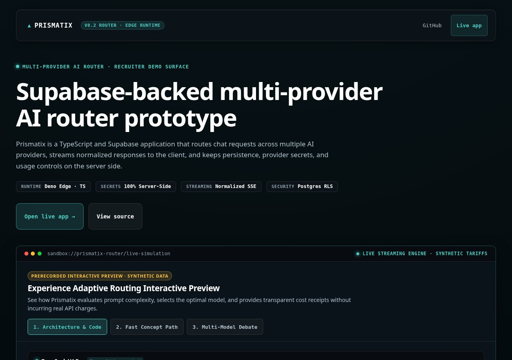
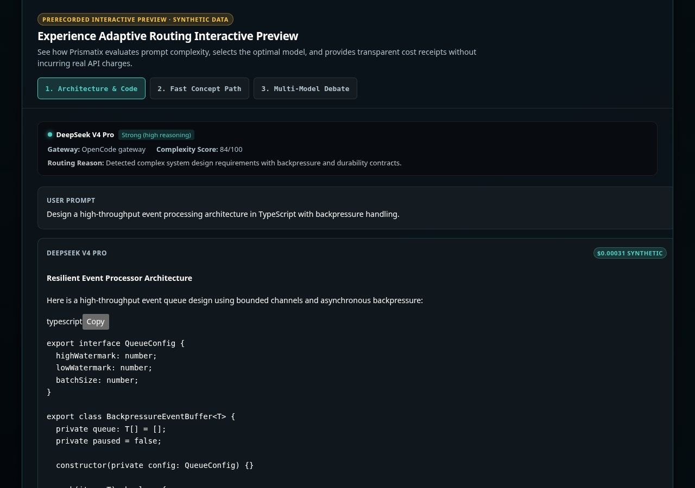
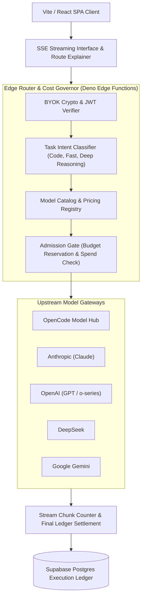

# Engineering Case Study: Prismatix

**Multi-provider AI chat with explainable model routing, streaming responses, and fail-closed pricing controls.**

[](../../assets/showcase/prismatix-overview.jpg)

## 1. Problem Being Solved

Developers and power users interacting with large language models face severe pricing fragmentation, unpredictable latency, and vendor lock-in. A simple query might needlessly invoke an expensive reasoning model costing dollars per session, while a complex technical inquiry routed to a lightweight model yields unusable hallucinations. Furthermore, standard multi-model frontends act as passive pass-through proxies: they do not explain why a particular model was chosen, and they fail open when pricing changes, risking unexpected cloud billing surges.

Prismatix addresses this by introducing an **explainable, cost-governed multi-provider gateway**. Every incoming request is classified by task intent, matched against verified real-time pricing and capability tables, streamed with full Server-Sent Events (SSE) responsiveness, and strictly bounded by fail-closed budget controls.

## 2. Intended Users

- **AI Practitioners & Power Users**: Developers wanting direct access to state-of-the-art models (Anthropic Claude, OpenAI GPT, Google Gemini, DeepSeek) through a single unified interface with transparent cost attribution.
- **Cost-Conscious Organizations & Freelancers**: Teams needing hard budget ceilings, per-session cost tracking, and automatic cost-effective routing for high-volume chat workflows.
- **Frontend & Full-Stack Engineers**: Developers studying modern real-time streaming architectures, BYOK (Bring-Your-Own-Key) credential cryptography, and edge-native routing.

## 3. Why the Problem Is Technically Difficult

1. **Low-Latency Streaming with Dual-Sided Accounting**: Standard HTTP proxying buffers responses, destroying perceived interactive streaming speed. Streaming tokens via Server-Sent Events (SSE) while concurrently accumulating token counts, calculating fractional cents, and enforcing pre-inference budget reservations requires tight stream lifecycle management.
2. **Fail-Closed Financial Boundaries at Edge**: If a provider updates their pricing or returns an unknown model identifier, naive routers continue dispatching traffic and incurring untracked charges. Prismatix implements fail-closed admission: if a model is missing registered pricing or budget holds cannot be established, execution is rejected (HTTP 409 for unpriced models, HTTP 503 for admission/ledger failures) before invoking any external provider.
3. **Client-Side Key Privacy (BYOK)**: Users provide sensitive third-party API keys. Keys must never be stored in plain text or leaked through logs, server telemetry, or cross-tenant edge storage.

## 4. Architecture and Major Subsystems

[](../../assets/showcase/prismatix-architecture.jpg)



- **Frontend Client (Vite + React + TypeScript)**: Features markdown code syntax highlighting, thinking-process accordions, model selector dropdowns, and an inline Route Explanation Inspector showing exactly why Auto-routing picked a model.
- **Edge Router (Deno Edge Functions)**: Edge-native handler that verifies authentication, resolves the model route, establishes pre-inference budget holds, and proxies streaming tokens.
- **Model Pricing & Capability Registry**: Curated catalog mapping model identifiers to input/output token pricing, context limits, tool capabilities, and benchmark tiers.
- **Execution Ledger (Supabase / Postgres)**: Records execution records, token usage metrics, final settled costs, and user budget balance quotas.

## 5. Important Engineering Decisions

- **Pre-Inference Admission Reservation**: Before a request reaches an external LLM provider, Prismatix verifies that the user has sufficient remaining budget and writes a tentative reservation. Once streaming terminates, the ledger settles the exact cost based on actual tokens emitted.
- **Explainable Model Selection**: When set to "Auto" mode, Prismatix does not obscure the decision. The UI renders a dedicated explanation card detailing the evaluated task class, the primary model selected, the fallback chain, and the cost basis.
- **Client-Side Key Encryption (AES-GCM)**: Connected BYOK keys are encrypted with authenticated credentials before storage and decrypted only inside isolated edge worker environments.

## 6. Alternatives and Tradeoffs

| Alternative Considered | Chosen Approach | Rationale |
|---|---|---|
| Centralized Paid API Proxy | BYOK (Bring-Your-Own-Key) Client Architecture | Completely eliminates subscription middleman markups and guarantees that user credentials remain under individual user ownership. |
| Buffered Full-Response HTTP | Low-Latency Server-Sent Events (SSE) Streaming | First-token latency is critical for user experience; SSE enables immediate feedback while tracking chunk lengths. |
| Fail-Open on Missing Model Metadata | Fail-Closed Rejection (HTTP 409 for unpriced models, HTTP 503 for admission outage) | Prevents unexpected cost surprises when upstream vendors alter model identifiers or pricing structures. |

## 7. Interesting Implementation Details

- **Debate & Multi-Perspective Orchestration**: Includes an experimental multi-agent debate mode where two distinct models evaluate opposing technical approaches to a prompt and synthesize an adjudicated consensus.
- **Stream Lifecycle & Disconnect Handling**: If the user cancels generation or closes the browser tab mid-stream, an `AbortSignal` immediately propagates to the upstream provider, halting token generation and terminating downstream billing.

## 8. Reproducible Tests and Validation

The project maintains extensive unit, integration, and E2E test suites:
- **Routing & Fail-Closed Tests**: Validate that unpriced models return HTTP 409 Conflict (`unknown_model_pricing`), unauthorized requests return HTTP 401, and database admission RPC / ledger failures return HTTP 503 (`admission_unavailable`, `accounting_unavailable`).
- **Stream Lifecycle Verifiers**: Test backpressure, abort signals, and stream chunk accumulation under simulated network interruptions.
- **UI Component Checks**: Verify model selector state, cost badge rendering, and conversation tree persistence.

Automated unit and integration test suites validate the routing and frontend surfaces:
```powershell
npm test
```

## 9. User-Facing Demonstration

Visiting the live application at [https://prismatix-app.vercel.app](https://prismatix-app.vercel.app):
1. The user selects "Auto-Router" or a designated frontier model.
2. An inquiry (e.g., an algorithmic systems coding question) is submitted.
3. The interface immediately renders the **Route Explanation**, highlighting that a deep reasoning model was selected due to complex code generation requirements.
4. Tokens stream in real time with live token count telemetry.
5. Upon completion, a verified Cost Badge displays the calculated session cost.

## 10. Current Limitations

- **Production Deployment Status**: The live production web deployment at [https://prismatix-app.vercel.app](https://prismatix-app.vercel.app) runs commit `7d143a1` (PR #59). Newer Wave 2 features (knowledge ingestion and multimodal auto-routing) exist on the default `main` branch (`5d8127f`) and are validated by tests.
- **Registered Tariffs, Not Cryptographic Proofs**: Pricing verification matches against a curated registry of provider pricing tariffs and enforces fail-closed execution rather than cryptographic pricing proofs.
- **Provider Outages**: Third-party model API downtime or gateway degradation directly affects route availability; the fallback chain mitigates but cannot eliminate upstream outages.
- **Free Tier Provider Limits**: When running under public demonstration mode with mock or community gateways, rate limits apply to prevent abuse.

## 11. Specific Contributions and AI-Assisted Workflow

- **Engineering Direction**: Conceived the explainable routing paradigm, designed the fail-closed cost governance contract, architected the SSE streaming pipeline, and defined security boundaries for BYOK keys.
- **AI Agent Pairing**: Used coding agents to construct mock fetch recorders, generate TypeScript interface typings, implement React UI modals, and draft regression tests for edge cases.

## 12. Links and Verification References

- **Canonical Repository**: [https://github.com/gthgomez/Prismatix](https://github.com/gthgomez/Prismatix)
- **Production Web Deployment**: [https://prismatix-app.vercel.app](https://prismatix-app.vercel.app)
- **On-Device Companion**: [https://github.com/gthgomez/PrismLocal](https://github.com/gthgomez/PrismLocal)
