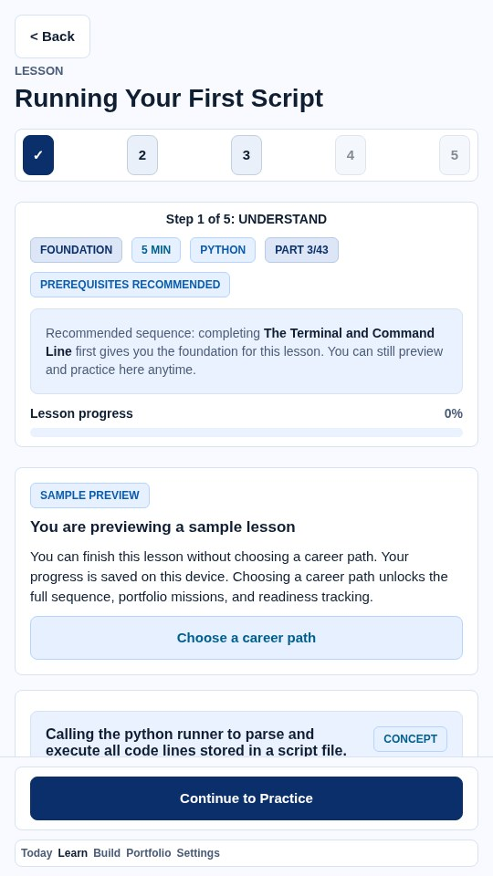
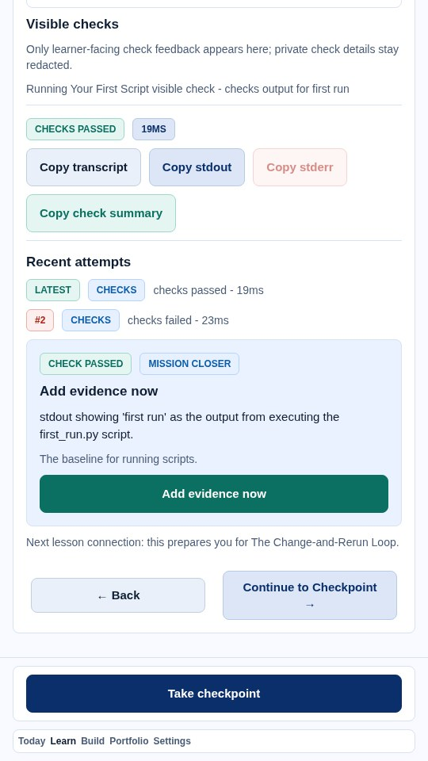
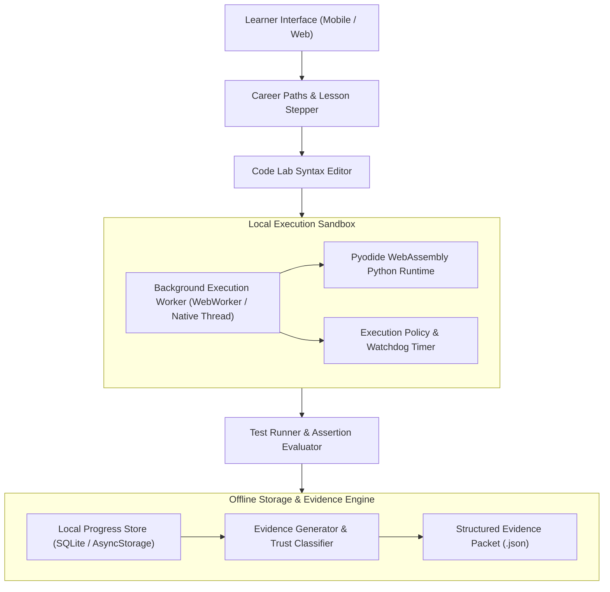
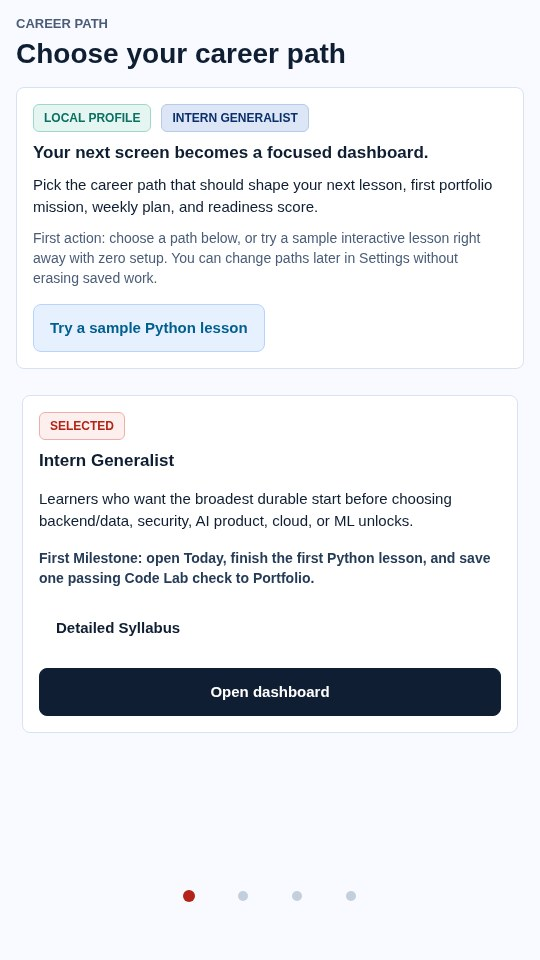

# Engineering Case Study: ProofPath

**Offline-first CS learning application with executable coding lessons, local progress tracking, and provenance-aware portfolio evidence.**

[](../../assets/showcase/proofpath-lesson.jpg)

## 1. Problem Being Solved

Most online computer science education platforms suffer from three structural shortcomings:
1. **Passive Video Watching**: Learners watch lectures or read tutorials without executing real code, leading to an illusion of competence that breaks down when confronted with a real terminal.
2. **Server-Dependent Execution**: Existing interactive learning platforms rely on expensive cloud sandboxes. If the student has poor internet connectivity or travels offline, the learning environment stops functioning entirely.
3. **Unverifiable Progress Claims**: Students complete online courses and receive unverified PDF certificates that recruiters cannot independently audit, verify, or inspect for code authenticity.

ProofPath solves these challenges by combining an **offline-first local execution sandbox** with **structured, provenance-aware portfolio evidence packets**.

## 2. Intended Users

- **Computer Science Students & Self-Taught Learners**: Students who need hands-on, test-driven programming exercises that run smoothly on laptops, tablets, or phones without requiring persistent cloud connections.
- **Bootcamp & Course Instructors**: Educators looking for structured, deterministic grading and offline progress tracking for curriculum delivery.
- **Hiring Managers & Technical Recruiters**: Evaluators who want to inspect reproducible proof that a candidate solved algorithmic coding challenges independently.

## 3. Why the Problem Is Technically Difficult

1. **Sandboxed In-Browser/In-App Code Execution**: Executing user-written Python code client-side without a remote backend requires compiling Pyodide (WebAssembly) or WebWorkers safely, enforcing execution time limits, preventing infinite loops from locking the UI thread, and intercepting standard I/O (stdout/stderr).
2. **Cross-Platform Responsive UX (Mobile & Desktop Web)**: Code editors typically fail on mobile screens due to virtual keyboard collisions, poor touch cursor selection, and cramped layouts. Designing a dual-surface touch-friendly syntax editor and desktop split-pane IDE in React Native / Expo requires meticulous UI engineering.
3. **Provenance-Aware Progress & Evidence Export**: Exported completion records must accurately track how work was validated. Rather than trusting self-reported claims, ProofPath implements a four-tier provenance trust model (`auto_verified_code_lab`, `reproduction_package_supplied`, `manual_verifier_output`, and `manual_note`), explicitly distinguishing locally executed test runner checks from unverified learner submissions.

## 4. Architecture and Major Subsystems

[](../../assets/showcase/proofpath-passing.jpg)



- **Curriculum & Career Path Engine**: Organizes lessons into structured engineering tracks (Python Fundamentals, Object-Oriented Design, Data Structures, Algorithms) with progressive unlocking and prerequisite gating.
- **Touch-Friendly Code Lab**: React Native editor featuring syntax highlighting, virtual indentation keys, line numbering, and inline error diagnostic callouts.
- **Client-Side Execution Worker**: Executes Python code in a dedicated worker thread using WebAssembly, isolating execution memory from the primary UI render loop.
- **Deterministic Assertion Verifier**: Automatically executes invisible grading test suites against learner functions to verify correctness, boundary edge cases, and algorithmic complexity.
- **Evidence Export Generator**: Produces machine-readable JSON packets containing DJB2 code hashes (`cf-` prefix), test run outputs, timestamped records, and trust tier classification.

## 5. Important Engineering Decisions

- **Offline-First by Design**: All core curriculum content, test runners, and WebAssembly binaries are bundled locally into the client. Learners can study, code, and pass verification checks on an airplane with zero network access.
- **Local Progress Persistence**: Progress is stored in a structured local SQLite database (`expo-sqlite` on native / indexed storage on web) with support for JSON migration and backup export/restore, ensuring students never lose completed milestones.
- **Dual Verification (Run File vs. Run Checks)**: Learners have access to two distinct execution modes: "Run File" outputs standard terminal stdout for interactive experimentation, while "Run Checks" executes the authoritative unit grading suite without leaking answers.

## 6. Alternatives and Tradeoffs

| Alternative Considered | Chosen Approach | Rationale |
|---|---|---|
| Server-Side Cloud Containers (Docker) | Local WebAssembly (Pyodide) Execution | Eliminates cloud hosting costs, prevents server downtime, operates offline, and guarantees infinite horizontal scalability. |
| Multiple Choice Quizzes | Test-Driven Code Implementation | Multiple-choice questions test memorization; test-driven coding proves actual programming competence. |
| Web-Only SPA | Cross-Platform React Native (Expo) | Enables native mobile Android/iOS deployment alongside responsive desktop web browsing. |

## 7. Interesting Implementation Details

- **Watchdog Timeout Protection**: User-submitted code is monitored by a strict watchdog timer. Infinite loops (`while True: pass`) are preemptively aborted, returning a friendly timeout diagnosis without freezing the device.
- **Sanitized Workspace Evidence**: Exported evidence manifests omit private device markers while preserving execution hashes and assertion records, making them safe to share publicly.

## 8. Reproducible Tests and Validation

The project maintains extensive automated test suites:
- **Sandbox Security & Timeout Tests**: Validate that unauthorized file system escapes and runaway loops are properly confined.
- **Curriculum Integrity Tests**: Static analysis ensuring all curriculum lessons have valid starter templates, test assertions, and reachable prerequisites.
- **UI Accessibility & Scale Checks**: Verify font scaling, dark/light contrast ratios, and touch target dimensions.
- **Evidence Trust & Export Tests**: Verify proper classification across all four provenance trust levels and confirm DJB2 content hashing behavior.

Automated test suites execute via Vitest across unit assertions and user journeys:
```powershell
npm test -- --run
```

## 9. User-Facing Demonstration

In the application:
1. Select a learning track (e.g., Python Core).
2. Open an introductory lesson (e.g., Variable Assignment & Conditionals).
3. Review the conceptual prompt and inspect the starter code in the Code Lab editor.
4. Execute "Run Checks" on incomplete code to observe failing unit assertions with diagnostic explanations.
5. Implement the solution and re-run checks to achieve a verified green pass.
6. Export a structured JSON evidence packet recording the code run, test outcomes, and provenance tier.

[](../../assets/showcase/proofpath-choose.jpg)

## 10. Current Limitations

- **Non-Cryptographic Code Hashing**: The code hashing function (`computeCodeHash`) uses a 32-bit DJB2 integer hash with a `cf-` prefix. It is designed for client-side change detection and deduplication, not cryptographic collision resistance or SHA-256 attestation.
- **No Digital Signatures**: Exported evidence records are structured JSON provenance packets that capture test runs and validation metadata. They are not cryptographically signed certificates.
- **Standard SQLite Persistence**: Persistence uses standard `expo-sqlite` and local storage without database-level encryption (SQLCipher).
- **Language Scope**: Client-side WebAssembly execution currently focuses on Python and TypeScript; compiled languages (C++, Rust) require separate toolchain support.
- **Initial WASM Load Time**: On slow mobile devices, the initial download and compilation of the Pyodide WebAssembly runtime takes several seconds before first-run caching takes effect.

## 11. Specific Contributions and AI-Assisted Workflow

- **Engineering Direction**: Conceived the offline-first educational architecture, designed the evidence provenance protocol, architected the React Native component hierarchy, and specified grading assertions.
- **AI Agent Pairing**: Used coding agents to draft modular lesson units, generate comprehensive test assertions, implement responsive styling across viewport breakpoints, and test accessibility properties.

## 12. Links and Verification References

- **Canonical Repository**: [https://github.com/gthgomez/ProofPath](https://github.com/gthgomez/ProofPath)
- **Live Preview & Test Documentation**: [https://github.com/gthgomez/ProofPath/blob/main/docs/README.md](https://github.com/gthgomez/ProofPath/blob/main/docs/README.md)
