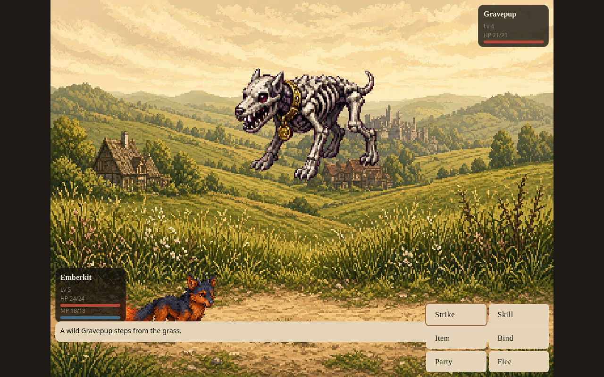
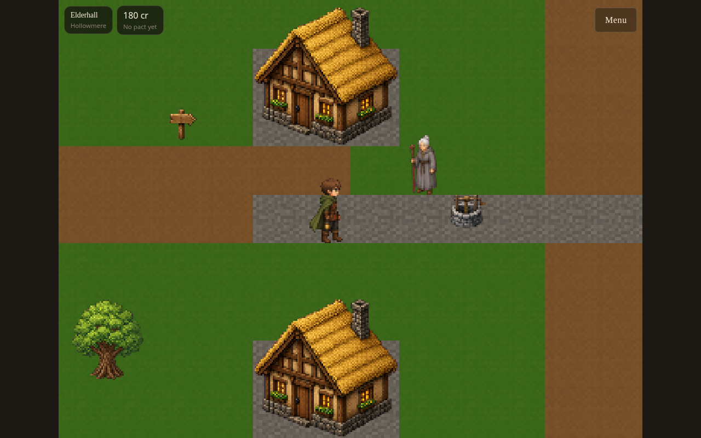
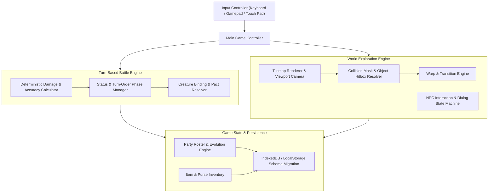
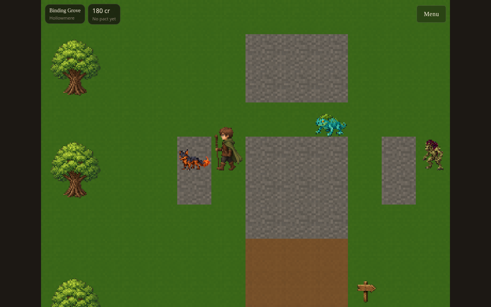

# Engineering Case Study: Reliquary

**Browser-based fantasy creature-collecting RPG with exploration, turn-based battles, progression, saving, and PWA support.**

[](../../assets/showcase/reliquary-battle.png)

## 1. Problem Being Solved

Web-based role-playing games frequently suffer from architectural shortcuts: physics tied to variable monitor refresh rates (causing animation desync), game state intertwined directly with DOM manipulation (causing memory leaks and UI lag), loose battle mathematics that lead to degenerate strategies, and volatile save states that break whenever new content is deployed.

Reliquary addresses these challenges by applying **rigorous software engineering principles to browser game development**. Designed in React and TypeScript with HTML5 Canvas, Reliquary separates pure headless game simulation from the presentation rendering layer, ensuring deterministic turn-based combat, robust collision detection, reliable state migration, and offline Progressive Web App (PWA) support.

## 2. Intended Users

- **RPG Enthusiasts & Nostalgic Gamers**: Players seeking a polished medieval-fantasy creature-binding RPG with turn-based tactical depth, rich lore, and seamless browser play.
- **Game Engine & Web Graphics Engineers**: Developers exploring clean architecture in web games, decoupling simulation from rendering, and managing tile-based world maps.
- **Full-Stack & TypeScript Developers**: Engineers examining how to implement reliable client-side state machines, save serialization, and touch/keyboard input handling.

## 3. Why the Problem Is Technically Difficult

1. **Decoupling Simulation from Animation Cycles**: In turn-based combat, damage calculations, MP deductions, and status effect expirations must resolve deterministically at the exact decision moment—independent of CSS transition times, frame drops, or whether the user switches browser tabs during an animation.
2. **Tile Collision & Safe Spawn Geometry**: Navigating continuous top-down maps requires solid foot collision masks, edge tile walking restrictions, warp trigger zones, and safe-spawn fallback algorithms to prevent player characters from becoming permanently wedged inside walls or decorative props.
3. **Save-State Evolution & Schema Versioning**: As game content expands (new creature species, expanded movesets, map layout updates), player save files stored in `localStorage` must cleanly migrate across game versions without corrupting party rosters or inventory items.

## 4. Architecture and Major Subsystems

[](../../assets/showcase/reliquary-exploration.png)



- **Headless Battle Simulation Engine**: Pure TypeScript combat engine managing party state, turn priority, elemental weaknesses, status conditions (Burn, Paralyze, Sleep), skill MP costs, and creature binding probabilities.
- **World & Tile Engine**: Scanline and tilemap renderer handling layer sorting (ground, props, actors, overhead canopies), camera smoothing, NPC pathing, and collision detection.
- **Party & Evolution System**: Manages creature levels, experience scaling, dynamic stat calculation (Attack, Defense, Speed, Magic), learnsets, and branched evolution criteria.
- **Dialog & Quest System**: Multi-choice branching dialog engine with portrait rendering, quest flags, NPC identity resolution, and shopkeeper economies.
- **PWA Service Worker & Save Migration**: Provides full offline gameplay caching and backward-compatible save serialization with schema migration guards.

## 5. Important Engineering Decisions

- **Deterministic Battle Resolution**: Combat calculations resolve immediately when the turn actions are confirmed. Visual animations (projectile particle effects, damage floaters, screen shakes) merely visualize the already resolved state. This guarantees that pausing the game or minimizing the window never causes missed or duplicated combat turns.
- **Pure Functional State Transitions**: Battle state updates are modeled as pure immutable functions, making every battle step reproducible, rewindable, and unit-testable in headless Node.js environments without a DOM.
- **Responsive Dual-Input Architecture**: Fully supports keyboard arrows/WASD, physical USB/Bluetooth gamepads, and an on-screen responsive touch D-pad for mobile gameplay.

## 6. Alternatives and Tradeoffs

| Alternative Considered | Chosen Approach | Rationale |
|---|---|---|
| Monolithic Commercial Game Engine (Unity/Godot Web Export) | Custom React + TypeScript + Canvas Engine | Tiny initial payload (< 2 MB vs 30+ MB WASM blobs), instantaneous browser load time, native DOM UI integration, and zero runtime licensing fees. |
| Server-Authoritative Multiplayer Backend | Client-Authoritative Single-Player PWA | Eliminates server hosting infrastructure, enables 100% offline gameplay, and guarantees zero latency during battles. |
| DOM-Based Element Sprite Rendering | Canvas 2D Bitmap Renderer | Canvas delivers consistent 60 fps rendering, hardware acceleration, and precise sprite atlas batching that standard DOM trees cannot sustain. |

## 7. Interesting Implementation Details

- **Safe Spawn Fallback Algorithm (`resolveSafeSpawn`)**: If a map migration moves a wall tile onto an existing saved player location, the engine automatically traverses adjacent reachable nodes using breadth-first search to reposition the player on a valid walkable tile.
- **Binding & Pact Formula**: Creature capture probability scales with the target's current missing HP, status condition severity, creature base capture difficulty, and the tier of the binding catalyst utilized.

[](../../assets/showcase/reliquary-starters.png)

## 8. Reproducible Tests and Validation

The project maintains comprehensive automated test coverage:
- **Battle Determinism Tests**: Validate that skill accuracy, critical strikes, and status expirations resolve identically regardless of animation elapsed time.
- **Content Integrity Checks**: Verify that every skill, creature learnset, evolution target, map warp, and NPC dialog identifier is internally valid.
- **Save Migration Invariants**: Test that loading older save file schemas safely hydrates party stats and inventory items.

Over 260 tests execute via Node.js test runner:
```powershell
npm test -- --run
```

## 9. User-Facing Demonstration

Visiting the live deployment at [https://reliquary-dusky.vercel.app](https://reliquary-dusky.vercel.app):
1. Start a New Game or Continue from a saved local session.
2. Explore Elderhall, interacting with townspeople and reviewing the starter creature choices.
3. Form a pact with an initial companion and venture into wild tall-grass zones.
4. Engage in turn-based combat: command elemental strikes, manage MP reserves, and utilize binding items to capture new creatures.
5. Inspect the Party menu to review companion stats, manage active movesets, and observe experience growth toward evolution.
6. Save progress locally and resume instantly at any time.

## 10. Current Limitations

- **Browser Audio Autoplay Policies**: Modern browsers require an explicit user gesture (click or keypress) before web audio context can initialize music playback.
- **Scope & Content Expansion**: While the core engine, battle system, and initial zones are complete, additional creature species and extended world biomes continue to be developed.

## 11. Specific Contributions and AI-Assisted Workflow

- **Engineering Direction**: Architected the simulation/rendering decoupled pipeline, balanced the turn-based combat mathematics, established map tile collision schemas, and directed UI layout responsiveness.
- **AI Agent Pairing**: Used coding agents to write exhaustive combat state unit tests, generate sprite sheet coordinate mappings, validate JSON content schemas, and implement touch controller input abstractions.

## 12. Links and Verification References

- **Canonical Repository**: [https://github.com/gthgomez/reliquary](https://github.com/gthgomez/reliquary)
- **Live Playable Web Deployment**: [https://reliquary-dusky.vercel.app](https://reliquary-dusky.vercel.app)
- **Architecture Documentation**: [https://github.com/gthgomez/reliquary/blob/main/docs/ARCHITECTURE.md](https://github.com/gthgomez/reliquary/blob/main/docs/ARCHITECTURE.md)
